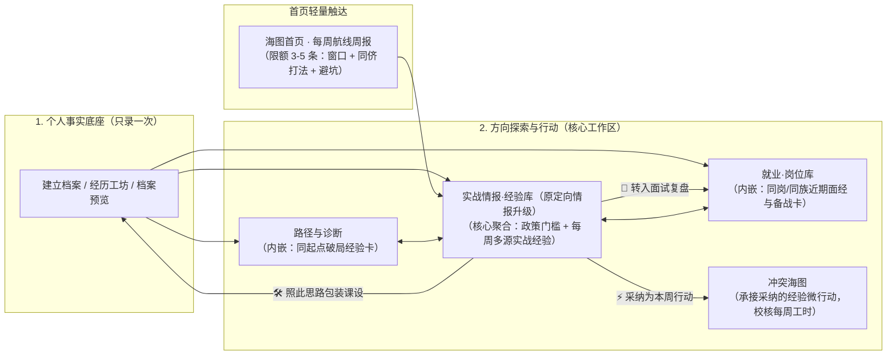

# Course Compass 实战经验情报采集与个性化推送系统 · 产品需求规格说明书（PRD）

> **SDD 规范元数据（Spec Metadata）**
> - **Spec ID**：`CC-SDD-EXP-01-PRD`
> - **版本**：`v1.0.0`
> - **状态**：`Draft · Ready for Review`
> - **基线分支 / 提交**：`feat/experience-intel-crawler`（基于 `origin/main` @ `0c90366`）
> - **关联规格书**：
>   - 技术与架构设计规格书：[02-TECH-ARCH-experience-intel.md](./02-TECH-ARCH-experience-intel.md)
>   - 演进路线与任务拆解规格书：[03-ROADMAP-experience-intel.md](./03-ROADMAP-experience-intel.md)

---

## 1. 背景与深度产品调研（Product Research）

### 1.1 Course Compass 现存能力与核心断层

基于合并后的主干基线（`0c90366`），**Course Compass（大学航线）** 已经打通了「**个人事实档案 → 经历工坊 → 档案预览 → 开放式四路径诊断（保研 / 考研 / 留学 / 就业）→ 八维确定性岗位匹配（31.8 万仓 + 实时官网 ATS）→ 实时时间冲突海图**」的完整决策骨架。

然而，在真实大学生升学与求职决策链路中，现有系统仍存在**三大产品断层**：

1. **有「显性硬门槛（What）」，缺「同起点隐性打法（How）」**：
   - 现有引擎能精确告知学生“距离本校保研线差 4 名”、“距离腾讯后端实习还缺 `redis` 与 `golang` 实证”，但无法回答学生最迫切的实操追问：*“和我一样双非大三、零实习起步的学长，是如何在春招前用 4 周补齐项目拿到第一份日常实习的？”*、*“今年该岗位一面真实高频深挖了哪些问题？”*、*“排名 18% 边缘如何通过预推免与九推捡漏？”*。
2. **「定向情报」模块停留在静态原型（16 条硬编码死规则）**：
   - 当前 [`index.html`](../../index.html) 中的 `INTEL_RULES` 仅有 16 条写死的规则卡片（详见 [`TECH.md`](../../TECH.md)）。学生读完一次后便再无活水输入，无法感知外部世界每周都在发生的变化（如当季大厂面经风向转移、新增专项推免经验、新兴技术栈如 AI Agent / 具身智能的校招实操门槛）。
3. **产品使用结构（信息架构）存在割裂**：
   - `定向情报` 被放置在左侧导航栏最底部的「辅助与架构」分组中（与面向开发者的 `引擎与技术` 并列），脱离了核心探索动线；
   - `海图首页·信息雷达`、`定向情报`、`岗位详情·联网成长规划` 三处信息出口各自为政；
   - 缺少**「看到高价值前辈经验 → 一键转化为个人行动清单 / 面试复盘题库 / 经历工坊改造方案」**的执行闭环。

---

### 1.2 大学生外部经验渠道生态调研与痛点拆解

当前大学生获取升学与就业指导经验主要依赖外部 UGC 社区。经调研分析，各大渠道的内容特征、核心价值与突出痛点如下表所示：

| 渠道名称 | 核心覆盖路径 | 高价值指导内容资产 | 典型噪音与用户体验毒点 | 采集开放度与风控特征 |
| :--- | :--- | :--- | :--- | :--- |
| **小红书（Xiaohongshu）** | 保研、春/秋招、跨考、文商科/产品运营实习、选调考公 | 保姆级时间线复盘、双非/跨专业破局心路、夏令营入营真实背景 Bar、简历改前改后对比、冷门岗位避坑 | **软广重灾区**（MCN 矩阵号“评论区扣1领资料”、“私信发面经”实则推销数万元保过班）；标题党与容貌/学历焦虑放大 | 站内搜索强登录墙与签名风控；但公开分享笔记（`/explore/`）被外部搜索引擎广泛收录 |
| **知乎（Zhihu）** | 保研/考研择校、行业认知、转码/硬科技长文攻略、留学申请复盘 | 逻辑严密的万字长文复盘、备考书单与复习节奏拆解、细分行业（芯片/嵌入式/量化/新能源）长期发展剖析 | 宏观贩卖焦虑（“劝退体”盛行）、高赞回答年份陈旧（3–5 年前政策误导当届学生）、付费盐选/机构引流软文 | 站内检索有反爬校验；知乎专栏（`zhuanlan.zhihu.com`）与精选问题公开页可经搜索引擎发现 |
| **牛客网（Nowcoder）** | 理工科/互联网/车企/国企银行校招、暑期与日常实习面经、笔试真题 | **极高信噪比的一线面经**（一面/二面/HR面具体追问）、开奖薪资与部门避雷、时间线进度（Timeline） | 圈层集中在泛计算机/电子硬件，人文社科覆盖较弱；部分晒 SP Offer 帖容易引发同辈幸存者偏差焦虑 | 讨论区与面经详情页公开可读性高，结构化标签（公司/岗位/届别）清晰 |
| **GitHub 开源经验仓** | CS/AI/电子保研绿皮书、校招面经汇总、开源课设进阶指南 | 零商业软广、社区 PR 持续勘误、体系化强（如各校夏令营考核方式汇总、八股与系统设计实战仓库） | 分散在不同 Repo 中，非计算机专业学生难以主动检索发现 | 完全开放合规，天然 Markdown 结构，极易通过 Firecrawl 或 API 增量同步 |
| **B站专栏 / 掘金 / 高校就业网** | 技术栈自研教程、课设工程化改造、本校/目标院校官方就业与推免通报 | 实操步骤完整的代码级项目复盘、A 级官方招考与推免细则原文 | B站视频正文需转写，专栏文章质量参差不齐，需严格筛选“方法论密度” | 公开网页友好，遵守 `robots.txt` 前提下适合 Firecrawl 直接抓取清洗 |

#### 调研核心洞察（痛点总结）

1. **信息茧房与焦虑螺旋**：商业社区推荐算法以完播率与互动率为目标，学生点开一篇“秋招0 Offer”或“人均清北5个SP”后，会被持续投喂焦虑内容与高价辅导广告。
2. **幸存者偏差与背景错配**：脱离**作者起点背景**（院校层次、专业大类、绩点排名区间、起步是否有实习）谈经验毫无指导意义——顶尖科班大佬的“裸考上岸”对零基础或双非同学甚至是反向误导。
3. **“收藏吃灰”死循环**：超过 80% 的学生在小红书/知乎建立庞大的收藏夹，但从未拆解出一件**本周 4 小时内可落地的具体动作**。

---

### 1.3 产品破局定位

Course Compass 不做“搬运原文的聚合阅读器”，而是打造 **「反焦虑 · 零软广 · 同起点对标 · 阅后即行动」的每周实战经验情报引擎**：

- **用本地/云端 Firecrawl 每周定时巡航多渠道公开经验**；
- **用四重清洗网关剥离软广与情绪鸡汤，只提炼结构化方法论、面经真题与作者起点锚点**；
- **用个人事实档案（起点相似 + 技能缺口互补 + 学制窗口共振）驱动可解释推送**；
- **一键回流至经历工坊、面试复盘与时间冲突海图，让每一篇好经验变成学生档案里的一块真实砖石**。

---

## 2. SDD 宪法原则与明确边界（Constitutional Rules & Out-of-Scope）

> [!IMPORTANT]
> 以下条款为系统级刚性约束，后续架构设计、代码实现与 AI Agent 自动演进均不得违反。

### 2.1 SDD 宪法红线（Constitutional Constraints）

- **`CONST-01`（合规采集与反爬边界红线）**：严禁破解、绕过任何平台的登录墙、滑块/点选验证码（CAPTCHA）、设备指纹校验或私有加密签名接口；严格遵守目标站点 `robots.txt` 与请求速率限制。针对小红书、知乎等强风控站点，统一采用**公开搜索引擎索引发现（Firecrawl `/v2/search`）+ 公开可达落地页抓取（`/v2/scrape`）**，遇 `401/403/429` 或登录拦截立即优雅降级或跳过，绝不强行重试对抗。
- **`CONST-02`（事实与经验分级隔离红线）**：社区经验贴一律标记为 `B_EXPERIENCE`（经清洗核验的指导性经验）或 `C_CLUE`（低置信线索，不进入主动推送），**严禁将网友个体经验混同于 `A_OFFICIAL` 官方政策或硬性录取门槛**；单篇孤立经验必须显著标注 `个体实战样本 · 非官方硬门槛`。
- **`CONST-03`（反软广与防沉迷红线）**：所有引流卖课、付费内推、代写包装、纯情绪宣泄内容必须在入库前拦截；前端严禁设计“无限下拉刷流（Infinite Scroll）”，周报主动推送严格限制在每周 **3–5 条** 高匹配精选。
- **`CONST-04`（双模运行与零本地显存红线）**：必须同时支持 **GitHub Pages 纯静态免安装版**（基于每周 GitHub Actions 自动更新的内联精选快照 + 前端同构精排引擎）与 **本机/容器 `node _serve.mjs` 全量服务版**（直连本地 `_research/experiences.db` SQLite 仓 + Firecrawl 本地服务）；默认保持 **Zero-GPU 零本地显存占用**。
- **`CONST-05`（个人隐私与版权尊重红线）**：入库文本执行双层 PII 脱敏（剥离微信号、手机号、QQ群、邮箱、学号及真实姓名）；系统仅存储**结构化提炼摘要、核心步骤要点、脱敏面经问题与原文出处链接（`sourceUrl`）**，不全文镜像盗版长文，点击“查看原文”直达原平台作者页面。

### 2.2 明确不做（Out of Scope）

1. **不做站内社区发帖/评论社交功能**：保持工具纯粹性，避免审核合规风险与水贴污染。
2. **不做实时高频秒级监控爬虫**：定位为“每周固定巡航 + 按需手动增量同步”，不追求全网全量舆情监控。
3. **不绑定用户个人小红书/知乎账号 Cookie 进行后台代爬**：避免导致学生个人社交账号被平台封禁的风险。

---

## 3. 产品使用结构优化方案（UX & Information Architecture）

### 3.1 导航与信息架构重塑（从“边缘辅助”升级为“一核三嵌”）

针对现有版本将 `定向情报` 藏在底部辅助栏的问题，重构为 **「一核三嵌 + 三向行动回流」** 的闭环使用结构：

### 3.2 四大核心触达场景优化细节

1. **左侧导航重构**：
   - 将原「辅助与架构 → 定向情报」上移至第二分组「**方向探索与规划**」中，紧随 `路径与诊断` 与 `就业·岗位库` 之后，更名为 **「实战情报」**（保留未读高优角标，仅统计评分 $\ge 75$ 的高相关未读项，杜绝红点骚扰）。
   - 原「辅助与架构」更名为「**系统与透明性**」，保留 `引擎与技术`（扩展展示每周爬取源健康状态、反软广拦截漏斗、推送公式命中拆解与自更新日志）。
2. **海图首页 ·「每周航线周报（Weekly Compass Digest）」**：
   - 将原静态 `📡 信息雷达` 升级为结构化周报卡片组，固定上限 **4 张卡片**（`1 条近期硬窗口提醒` + `2 条同起点前辈实战攻略/面经` + `1 条针对当前技能缺口的项目打法或避坑指南`），支持一键「标记本周已阅」折叠收起。
3. **路径与诊断页 ·「同路人怎么破局」内嵌模块**：
   - 在保研、考研、留学、就业四个诊断标签页底部（`本周一件事` 旁），自动挂载 **2 条** 与当前用户 `院校梯度 + 专业族 + 绩点/经历基线` 最相似的真实经验卡（例如：对排名 22% 的理工科同学展示 *《双非前 25% 无顶会，如何靠高含金量硬件课设在 9 月预推免逆袭 211》*）。
4. **就业·岗位库详情页 ·「真实面经追问与上岸攻略」**：
   - 在岗位详情抽屉/页面中，基于岗位所属 `familyId`（岗位族）、`org`（目标企业）与 `skills`（核心硬技能），自动关联近期牛客/小红书/知乎提炼出的 **高频面试真题与考察重点**，并支持一键「加入我的面试复盘题库」或「按此要求去经历工坊补强证据」。

### 3.3 经验情报卡片的标准化视觉解剖（Card Anatomy）

每张实战经验卡片摒弃冗长原文堆砌，统一呈现以下 **7 个高密度信息锚点**：

1. **分类与可信度顶栏**：`[面经真题 / 上岸复盘 / 项目破局 / 政策窗口 / 避坑指南]` + `[B 级·多源印证（近30天4篇提及） | B 级·单样本参考]` + `[渠道图标：小红书 / 知乎 / 牛客 / GitHub]` + `[发布日期 / 适用届别]`。
2. **作者起点对标条（Peer Baseline Pill）**：如 `👤 作者起点：双非一本 · 计算机类 · 排名 15%-30% · 起步零实习`（缺失项如实标 `未披露`，绝不编造）。
3. **一句话核心结论（TL;DR）**：60 字以内直击指导价值。
4. **为什么推给你（Explainable `why[]` Chips）**：如 `命中缺口：Redis / Go 微服务`、`同为零实习冷启动`、`距暑期实习开闸 28 天`。
5. **结构化可执行干货（展开态）**：
   - **关键步骤（2–4 步）**：按时间序或优先级排列的实操动作；
   - **真实面经追问 / 硬指标参考**（如有）：原帖提及的面试问题或入营/笔试客观情况；
   - **前辈踩坑预警**：原帖明确指出的弯路。
6. **一键行动转化栏（Action Bar）**：
   - `⚡ 采纳进本周行动（预计 Xh）` | `🎯 收入面试题库` | `🛠️ 去经历工坊参考` | `🔗 查看原帖出处`
7. **轻量反馈控件**：`👍 有指导价值` | `👎 背景不符 / 软广嫌疑（带细分原因一键反馈）`。

---

## 4. 功能需求规格与验收标准（Functional Requirements）

### 4.1 多源合规采集模块（Ingestion）

- **`REQ-ING-01` 多渠道每周定时巡航采集**
  - **描述**：系统支持按固定周期（默认每周日 22:00 自动执行，支持本机命令行手动触发）调用本地仓库集成的 Firecrawl 能力，从知乎、小红书、牛客网、GitHub 开源经验仓、B站专栏及高校公开就业通知采集指导性经验内容。
  - **验收标准（Given / When / Then）**：
    - *Given* 到达每周预定调度窗口或管理员在本机执行同步脚本；
    - *When* 采集器按当期检索种子执行发现与抓取；
    - *Then* 成功生成带唯一 `runId` 的采集批次记录，完整记录各渠道请求数、成功入库数、跳过/受限数及耗时，单渠道故障不阻塞其余渠道完成入库。

- **`REQ-ING-02` 风控感知与零对抗优雅降级**
  - **描述**：当目标页面返回 `401/403/429`、重定向至登录页或 Firecrawl 标记 `blocked: true` 时，采集器必须立即停止对该受限端点的深抓，严禁尝试验证码绕过或注入未授权凭证。
  - **验收标准**：
    - *Given* 某小红书或知乎 URL 触发登录墙或 `HTTP 429`；
    - *When* 采集器检测到受限响应；
    - *Then* 自动将该渠道置入冷却窗口（Cooldown），若搜索索引摘要已具备完整指导步骤则降级记录为 `snippet_only` 线索，否则安全丢弃并更新 `experience_sources` 健康状态表。

### 4.2 四重清洗与结构化蒸馏模块（Distillation & Anti-Spam）

- **`REQ-CLN-01` 软广、引流黑产与纯焦虑帖精准拦截**
  - **描述**：入库前通过确定性规则特征库 + 免费云端大模型分类器双重筛查，拦截包含私信领资料、评论区扣数字引流、付费保过/内推广告、代写竞赛/论文及无实操方法论的纯情绪宣泄帖。
  - **验收标准**：
    - *Given* 一批包含典型引流话术（如“无偿分享面经，评论区扣666私我”、“报了XX学长一对一终于上岸”）与真实复盘贴的混合测试集（$\ge 50$ 条）；
    - *When* 通过清洗流水线；
    - *Then* 软广拦截准确率（Precision）$\ge 95\%$，真实硬核经验贴误杀率 $< 5\%$，被拦截记录保留原因码供审计但绝不进入公开快照或前端展示。

- **`REQ-CLN-02` 指导性要素与作者起点结构化抽取**
  - **描述**：将非结构化 Markdown 正文蒸馏为符合 JSON Schema 契约的结构化卡片，包含作者起点画像（院校梯度、专业大类、届别、起步状态）、适用路径（`baoyan/kaoyan/liuxue/jiuye`）、对齐 `TAXONOMY_VERSION = '2026.11.3'` 的 83 项标准 `skillId`、2–4 条关键行动步骤、踩坑提示及建议微任务工时。
  - **验收标准**：
    - *Given* 一篇公开求职或保研经验长文；
    - *When* 执行蒸馏管线（云端免费模型在线或离线回退至确定性规则抽取器）；
    - *Then* 100% 通过 `experience-intel.schema.json` 契约校验；文中未提及的作者背景字段严格输出 `null`（绝不猜测编造）；抽取的 `mappedSkillIds` 100% 属于引擎合法技能词表。

- **`REQ-CLN-03` 跨平台洗稿去重与多源交叉印证**
  - **描述**：对一稿多发或近似洗稿内容进行指纹合并；对近 30 天内多个独立来源共同提及的高频面试考点或夏令营动态自动聚合计数。
  - **验收标准**：
    - *Given* 同一篇经验贴同时发布于知乎专栏与牛客讨论区；
    - *When* 流水线执行去重；
    - *Then* 仅保留信息完整度最高的一条主记录，并将另一条合并进 `alternateSources[]`；当 $\ge 3$ 篇独立作者帖子提及同一岗位族考点时，卡片自动生成 `近期 N 篇独立经验交叉提及` 标签。

### 4.3 个性化推送与精排引擎（Push & Ranking）

- **`REQ-RNK-01` 六维同构个性化精排与可解释性**
  - **描述**：综合「路径与职业方向契合度、同侪起点相似度、个人技能/证据缺口互补度、内容指导纯度、分类半衰期时效衰减、学制日历阶段共振」六大维度计算匹配分，并输出至少 2 条人类可读的命中依据（`why[]`）。
  - **验收标准**：
    - *Given* 两份不同起点的测试档案（如「双非汉语言大三·零实习」vs「计算机大三·有开源项目缺分布式缓存」）；
    - *When* 对同一批经验情报库执行 `buildExperienceIntel()` 排序；
    - *Then* Top-5 推荐结果呈现显著且合理的差异化（各自命中对应专业、起点与技能缺口），每张卡片展示非空且忠于档案事实的 `why[]` 标签，且纯前端静态模式与服务端接口输出排序完全一致。

- **`REQ-RNK-02` MMR 多样性重排与周报防过载限流**
  - **描述**：引入最大边缘相关性（MMR）抑制同质化刷屏，保证 Top-5 结果不会全部集中在单一企业或单一知识点，海图首页周报主动推送严格限额 3–5 条。
  - **验收标准**：
    - *Given* 候选池中存在 10 篇高度相似的“Java 八股面经”；
    - *When* 生成用户首页周报与情报流首屏 Top-5；
    - *Then* 同一细分主题在首页周报中最多出现 2 条，其余席位自动分配给时间窗口预警、项目改造或避坑类高分异构卡片。

### 4.4 自我更新与闭环进化模块（Self-Updating）

- **`REQ-UPD-01` 动态检索词自进化（Query Self-Evolution）**
  - **描述**：每周巡航前，系统根据「当前自然月对应的升学/校招日历节点」+「岗位仓近期新增高频技能词差分」+「历史高采纳率检索词表现」自动生成下一轮采集 Query 列表，无需人工每周手改关键词。
  - **验收标准**：
    - *Given* 系统时间进入 3 月（暑期实习与夏令营前夕）且岗位仓内 `ai_agent_workflow` 岗位占比上升；
    - *When* 运行 `QueryPlanner` 生成本周抓取计划；
    - *Then* 自动提升“暑期实习面经”、“夏令营入营准备”及“AI Agent 项目实战经验”相关检索词权重，并写入 `crawl_runs` 审计日志。

- **`REQ-UPD-02` 存量内容失效巡检与届别自动归档**
  - **描述**：定期抽检高曝光经验卡的原链接可达性；当自然时间跨入新毕业届别周期时，自动将上一届强时效动态降级为“往届参考”并下调时效分。
  - **验收标准**：
    - *Given* 某已入库经验贴原链接返回 `404` 或标记已删除，或某经验贴绑定届别已早于当前主力校招届别；
    - *When* 执行周度自检任务；
    - *Then* 失效死链自动移出默认推荐流，往届帖子自动附带 `[往届经验·注意核对当年最新变化]` 提示条。

- **`REQ-UPD-03` 本地零知识用户反馈闭环重排**
  - **描述**：用户在本地执行的「收藏」、「采纳进本周行动」、「收入面试题库」、「忽略（背景不符 / 已有同类 / 疑似软广）」实时更新本地偏好权重向量，下一轮渲染即时生效。
  - **验收标准**：
    - *Given* 用户对某细分标签或平台连续点击「忽略·背景不符」；
    - *When* 重新计算推荐流；
    - *Then* 同类标签卡片匹配分按衰减系数下调，而用户点击「⚡ 采纳进本周行动」的同类实战卡获得正向加权，全过程零个人身份数据上传。

### 4.5 行动转化闭环模块（Action Integration）

- **`REQ-UX-01` 一键转化为冲突海图行动项与面试复盘题**
  - **描述**：经验卡内的建议动作可一键加入全局行动清单（自动计入每周工时预算并在冲突海图展示负荷预警），面经卡内的真实追问可一键导入「就业·岗位库 → 面试复盘」。
  - **验收标准**：
    - *Given* 学生每周可用时间为 `6h`，当前已排满 `5h` 任务；
    - *When* 学生在某篇经验卡点击「⚡ 采纳进本周行动（预计 3h）」；
    - *Then* 行动项成功写入个人状态，且 `冲突海图` 立即实时重算并给出“本周计划负荷 8h 超出可用预算 6h”的诚实预警。

---

## 5. 非功能性需求与成功衡量指标（NFRs & KPIs）

| 维度 | 规格指标要求 | 验证方式 |
| :--- | :--- | :--- |
| **前端精排性能** | 在内嵌 300–500 条精选经验卡片快照规模下，浏览器端完成六维打分 + MMR 重排耗时 `P95 < 25ms`，首屏零卡顿 | `_smoke.mjs` 性能基准断言 |
| **静态包体积预算** | 内联至 `index.html` 的精选经验快照压缩前增量严格控制在 `< 280 KB`（全量历史留存于 `_research/experiences.db`） | `_build-inline.mjs --check` 体积门禁 |
| **采集与蒸馏成本** | 100% 兼容本地 `firecrawl-local` + 魔搭/硅基流动/智谱免费模型池，单次周度巡航（约 80–150 篇候选）**零付费 API 账单、零本地 GPU 抢占** | 周度巡航运行日志审计 |
| **推荐质量核心指标** | 试用评测集 `NDCG@5 >= 0.78`；软广漏放率 `< 2%`；学生阅读经验卡后的「有效行动转化率（收藏 / 采纳行动 / 转入题库）」$\ge 25\%$ | 扩展 `_employment-eval.mjs` 离线与试用评测 |
