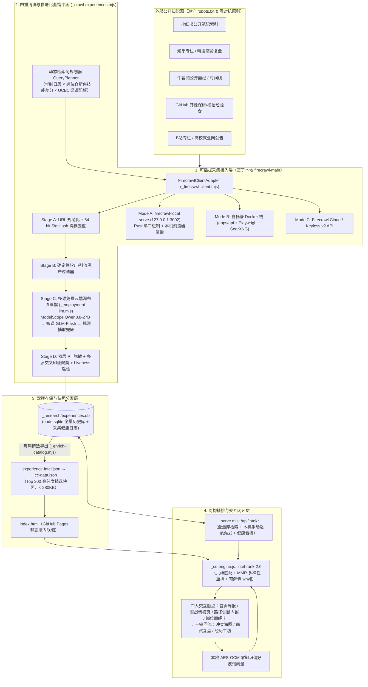
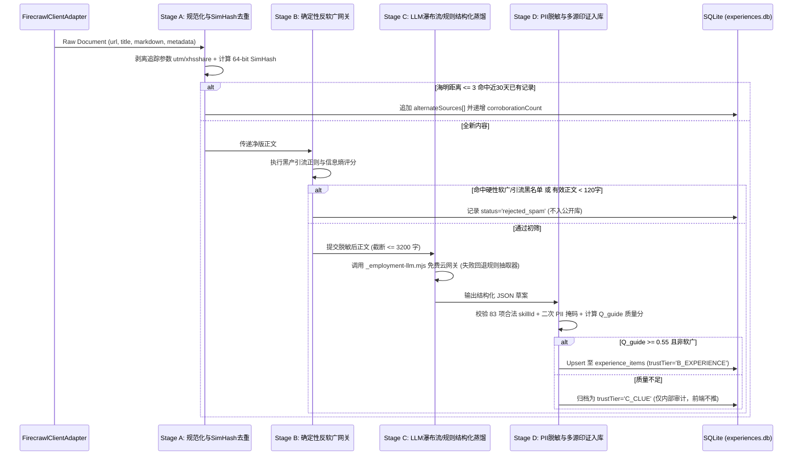
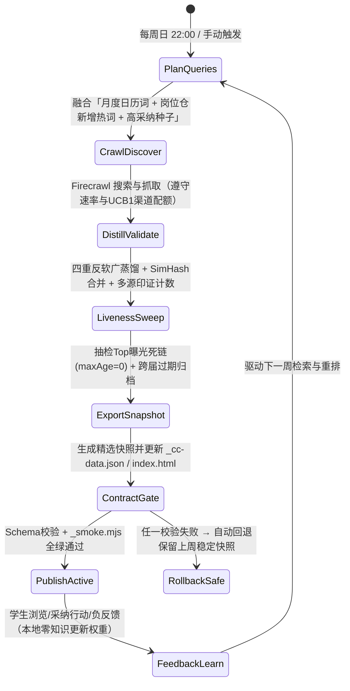

# Course Compass 实战经验情报采集与个性化推送系统 · 技术与架构设计规格说明书

> **SDD 规范元数据（Spec Metadata）**
> - **Spec ID**：`CC-SDD-EXP-02-TECH-ARCH`
> - **版本**：`v1.0.0`（技术文档与系统架构文档合一规范）
> - **状态**：`Draft · Ready for Review`
> - **上游依赖**：[`01-PRD-experience-intel.md`](./01-PRD-experience-intel.md)
> - **本地集成组件**：
>   - 主项目仓库：`D:\course-compass-review`（Node.js `>= 22.5.0`，内置 `node:sqlite`，Vanilla 同构引擎 `_cc-engine.js`）
>   - 采集底座仓库：`E:\github_bag\firecrawl-main\firecrawl-main`（Firecrawl v2 API / `apps/local` Rust 单体服务 / `apps/api` 自托管容器栈）

---

## 1. 总体系统架构设计（System Topology）

遵循 Course Compass 既有的 **「离线重采集蒸馏 · 线上确定性毫秒级同构对表 · 静态与本地双模无缝运行」** 核心工程哲学，整体架构划分为四个解耦平面：



### 1.1 关键架构决策（Architectural Decision Records, ADRs）

- **ADR-01（为什么采集与精排严格读写分离）**：外部网页抓取与大模型结构化蒸馏耗时在秒级（`2s–10s/篇`），绝不能阻塞学生打开页面。因此采集与蒸馏在**后台周度批处理（Weekly Batch）**完成，线上匹配排序由 `_cc-engine.js` 纯函数在 **`< 25ms`** 内确定性完成。
- **ADR-02（为什么前后端同构实现 `intel-rank-2.0`）**：Course Compass 需要同时交付 `https://kuchaishi.github.io/course-compass/` 纯静态免安装版与 `node _serve.mjs` 本机全量版。将精排公式内置于 `_cc-engine.js` 后，静态版可直接对内联的 300 条精选快照执行与服务端分毫不差的个性化推荐，而本地服务版则额外解锁 `_research/experiences.db` 万级历史库的全文检索与即时巡航同步。
- **ADR-03（零新增重型原生依赖）**：全栈复用项目现有的 Node.js `>= 22.5.0` 内置 `node:sqlite`（`DatabaseSync`）、`node:crypto` 与原生 `fetch`，无需引入 Python/Celery/PostgreSQL/Redis 即可在学生或开发者的 Windows/macOS/Linux 机器上一键跑通，仅在需要大规模分布式队列时可选挂载 `firecrawl-main/docker-compose.yaml`。

---

## 2. 基于本地仓库 `firecrawl-main` 的三模采集引擎设计

经核查本地仓库 `E:\github_bag\firecrawl-main\firecrawl-main`，其最新版本提供三种完全兼容 **Firecrawl v2 HTTP 契约** 的运行形态。我们在 Course Compass 中封装统一的 `_firecrawl-client.mjs` 适配器，通过环境变量无缝切换：

### 2.1 三种部署与接入模式对比

| 运行模式 | 对应 `firecrawl-main` 组件 | 启动与配置方式 | 本地 / 云端分工 | 适用场景 |
| :--- | :--- | :--- | :--- | :--- |
| **Mode A · 轻量本机模式（默认推荐）** | `E:\github_bag\firecrawl-main\firecrawl-main\apps\local`（Rust `firecrawl-local`） | 在 `apps/local` 执行 `cargo build --release` 后运行 `firecrawl-local serve --port 3002`；Course Compass 配置 `FIRECRAWL_API_URL=http://127.0.0.1:3002` | `/v2/scrape`、`/v2/crawl`、`/v2/map`、`/v2/batch/scrape` 100% 在本机运行（复用本机 Chrome/Edge 渲染动态 DOM）；`/v2/search` 按 `FIRECRAWL_CLOUD=search\|off` 转发或走公开检索源 | 日常本机开发、Windows 便携运行、无需 Docker 占内存 |
| **Mode B · 全栈自托管容器模式** | `E:\github_bag\firecrawl-main\firecrawl-main\docker-compose.yaml`（`apps/api` + `playwright-service-ts` + `nuq-postgres` + `redis` + `rabbitmq`） | 配置 `SEARXNG_ENDPOINT` 后启动 `docker compose up -d`，暴露 `http://127.0.0.1:3002` | 包含 `/v2/search`（对接自建 SearXNG 聚合搜索）与并发浏览器池在内 **100% 私有化闭环运行** | 服务器长期无人值守周度巡航、高并发多源采集 |
| **Mode C · 云端托管 / GitHub Actions 模式** | `https://api.firecrawl.dev/v2`（或 `npx firecrawl-cli` Keyless 免费额度） | 在 `.env.local` 或 GitHub Secrets 配置 `FIRECRAWL_API_KEY=fc-...` | 搜索发现与网页清洗均由 Firecrawl Cloud 执行（内置每月 1,000 次免费 Keyless 额度） | `.github/workflows/weekly-intel-sync.yml` 云端每周自动更新静态站快照 |

### 2.2 `FirecrawlClientAdapter` 标准调用契约

严格遵循 `firecrawl-main/skills/firecrawl-build` 规范，仅调用最窄化的两个核心原语，并显式区分 **Freshness（`maxAge`）** 与 **Liveness（业务存活判定）**：

1. **发现阶段：`POST /v2/search`（Query $\rightarrow$ 候选 URL 与索引摘要）**
   ```json
   {
     "query": "site:nowcoder.com/discuss \"2027届\" (\"暑期实习\" OR \"面经\") 后端 复盘",
     "limit": 10,
     "tbs": "qdr:w"
   }
   ```
   - `tbs: "qdr:w"` 锁定过去 7 天新发/新收录内容（冷启动建库首轮可设为 `"qdr:y"` 拉取近一年基线高赞干货）。
   - 先获取轻量 `{ url, title, description }` 进行 URL 去重与标题级黑产初筛，**绝盲目开启全量 `scrapeOptions` 浪费配额**。

2. **提取阶段：`POST /v2/scrape` 或 `POST /v2/batch/scrape`（已知高潜 URL $\rightarrow$ 净版 Markdown）**
   ```json
   {
     "url": "https://www.nowcoder.com/discuss/...",
     "formats": ["markdown", "links"],
     "onlyMainContent": true,
     "maxAge": 604800000,
     "timeout": 15000
   }
   ```
   - `onlyMainContent: true` 自动剥离导航栏、侧边栏广告与无关推荐噪声。
   - 常规采集设置 `maxAge: 604800000`（7 天缓存复用，提速降耗）；在执行存量死链存活复检（Liveness Check）时显式传入 `maxAge: 0` 穿透缓存探测真实状态。

### 2.3 五大渠道合规采集矩阵与风控降级策略

遵循 `CONST-01`，绝不逆向移动端签名或破解滑块，按渠道特性实施差异化采集路由：

| 渠道 ID | 目标域名与允许路径正则 | 采集路由策略 | 令牌桶限流（Rate Limit） | 受限（`403/429/blocked`）优雅降级动作 |
| :--- | :--- | :--- | :--- | :--- |
| `xiaohongshu` | `xiaohongshu\.com/(?:explore\|discovery/item)/[0-9a-f]+` | **Search-First**：通过 `/v2/search` 检索公开收录的经验笔记标题与摘要；仅对公开无登录墙可达页尝试单次 `/v2/scrape` | `1 req / 6s`，单轮上限 25 条 | 若返回登录重定向或 `blocked: true`，立即停止深抓该域名 30 分钟；若搜索摘要已含明确时间线/经验点则以 `extractMode: 'search_snippet'` 入候选池，信息不足则静默丢弃 |
| `zhihu` | `zhuanlan\.zhihu\.com/p/\d+` 或 `zhihu\.com/question/\d+/answer/\d+` | **Search + Column Scrape**：优先采集公开可读性更高的知乎专栏文章（`zhuanlan`） | `1 req / 5s`，单轮上限 30 条 | 触发安全验证页时立即熔断直连抓取，仅保留高质量专栏已缓存/索引片段 |
| `nowcoder` | `nowcoder\.com/(?:discuss/\d+\|feed/main/detail/[0-9a-f]+)` | **Search + Batch Scrape**：牛客公开面经与秋招总结 SSR 友好，支持批量提取正文 Markdown | `1 req / 3s`，单轮上限 40 条 | 遇 `HTTP 429` 指数退避一次后转入渠道冷却 |
| `github_exp` | `github\.com/[\w-]+/[\w.-]+`（匹配保研绿皮书 / 面经汇总仓库） | **Direct Map & Scrape / GitHub REST**：结合 `_employment-growth.mjs` 既有 GitHub 公开检索与 `firecrawl-local map/scrape` 提取优质经验 `.md` 章节 | `1 req / 2s`，仅限 MIT/CC/Apache 等开源许可仓库 | 记录 `ETag` / `commitSha`，未变更文件零重复解析 |
| `bilibili_edu` | `bilibili\.com/read/cv\d+` 及已登记高校就业网 `*.edu.cn` 公开经验/通知栏 | **Direct Scrape**：`firecrawl-local` 直接提取正文 Markdown（高校官方通知定级 `A_OFFICIAL`，专栏经验定级 `B_EXPERIENCE`） | `1 req / 3s`，单轮上限 25 条 | 校验 `robots.txt` 允许范围，异常时保留上一轮快照不覆盖 |

---

## 3. 四重反软广清洗与结构化蒸馏流水线（ETL Pipeline）

每条原始采集记录依次流经四个确定性/模型协同关卡，漏斗示意如下：



### 3.1 Stage A：URL 归一化与 SimHash 跨平台洗稿识别

1. **Canonical URL 归一化**：剥离 `utm_*`、`xhsshare`、`xsec_token`（仅用于单次抓取请求时不入公开永久链接或统一规范化为基础路径）、`spm` 等追踪查询串，生成唯一 `canonicalUrlHash = sha256(canonicalUrl)`。
2. **64-bit SimHash 近似去重**：对正文去除标点与高频停用词后提取中文 `3-gram` 特征计算 64 位 SimHash 指纹。若与近 30 天已入库条目的海明距离（Hamming Distance）$\le 3$，判定为跨平台同文搬运，不重复生成卡片，仅将新渠道链接记入 `alternateSources` 供交叉溯源。

### 3.2 Stage B：确定性反软广与低质内容硬拦截规则库

在消耗任何大模型额度前，先通过毫秒级规则引擎计算软广风险分 $R_{\text{ad}} \in [0, 1]$：

- **一票否决硬黑名单（命中任一即 `R_ad = 1.0` 直接拦截）**：
  - 私域引流诱导：`/(?:评论区|后台|主页|置顶).{0,8}(?:扣|留|回|私信|滴滴|dd)\s*[0-9a-zA-Z一二三四五六七八九十]{1,6}/i`
  - 机构卖课/付费内推：`/(?:保过班|全程托管|付费内推|保录取|VIP\s*1v1|名额有限先到先得|早鸟优惠|添加助教|扫码进群领)/i`
  - 学术不端黑产：`/(?:代写|代发|挂名论文|买科研|水赛保奖)/i`
- **软性营销信号累加（累计 $\ge 0.6$ 拦截或送大模型重点复核）**：
  - 全文感叹号/焦虑词密度过高且缺少任何具体时间节点、课程名、技术词或复盘步骤；
  - 文末出现非官方微信公众号导流或机构品牌词高频重复。

### 3.3 Stage C：复用多源纯免费云网关的结构化蒸馏与零显存兜底

直接复用 [`_employment-llm.mjs`](../../_employment-llm.mjs) 已建成的 **`Qwen/Qwen3.8-27B`（魔搭）→ `SiliconFlow` → `glm-4.7-flash`（智谱）** 免费瀑布流（离线批处理放宽单篇 `timeoutMs = 15000`，遵守平台 RPM 速率限制），严格输出如下 JSON 结构；当所有云端 Key 未配置或额度耗尽时，无缝降级至确定性规则抽取器 `extractExperienceDeterministic()`（复用 `_cc-engine.js` 的 `extractSkillsFromText`、届别/路径正则与段落祈使句切分）：

- **LLM 输出强制后验校验（Post-Extraction Grounding Gate）**：
  1. `mappedSkillIds` 必须与 `CC.extractSkillsFromText(rawText)` 或合法 `SKILL_BY_ID` 取交集验证，杜绝模型臆造不存在的 `skillId`；
  2. `interviewQuestions[]` 与 `hardMetrics[]` 中的关键短语必须在原文中可定位近似片段，防止模型自由发挥编造面经题；
  3. 作者背景（`schoolTier`、`majorFamily`、`rankBucket`、`startingBaseline`）若原文未明示，强制置为 `"unknown"`。

### 3.4 Stage D：内容指导纯度评分公式（$Q_{\text{guide}}$）

每篇通过校验的卡片在入库时预计算客观指导质量分 $Q_{\text{guide}} \in [0, 1]$：

$$Q_{\text{guide}}(d) = \text{clamp}_{[0,1]}\Big(0.30 \cdot \mathbb{I}_{\text{steps}}(d) + 0.25 \cdot \mathbb{I}_{\text{verifiable}}(d) + 0.20 \cdot \mathbb{I}_{\text{baseline}}(d) + 0.15 \cdot \min\big(1, \frac{\text{corroborationCount} - 1}{3}\big) + 0.10 \cdot \text{channelPrior}(d) - 0.50 \cdot R_{\text{ad}}(d)\Big)$$

其中：
- $\mathbb{I}_{\text{steps}}(d)$：提炼出 $\ge 2$ 条具体可执行动作步骤时取 `1`（仅 1 条取 `0.5`）；
- $\mathbb{I}_{\text{verifiable}}(d)$：包含真实面试追问、明确时间线节点、书单/开源仓库链接或客观排名区间时取 `1`；
- $\mathbb{I}_{\text{baseline}}(d)$：明确披露作者起点（院校层次/专业/起步经历至少两项）便于学生对标时取 `1`；
- $Q_{\text{guide}} < 0.55$ 的记录自动降级为 `C_CLUE`，不进入推荐池。

---

## 4. 数据模型与契约定义（Data Schemas & Contracts）

### 4.1 SQLite 持久化数据库 Schema（`_research/experiences.db`）

使用 Node.js 内置 `node:sqlite` 管理全量采集状态、源健康度与结构化经验库：

```sql
-- 1. 采集渠道健康度与自适应配额表
CREATE TABLE IF NOT EXISTS experience_sources (
  source_id         TEXT PRIMARY KEY,          -- xiaohongshu | zhihu | nowcoder | github_exp | bilibili_edu
  display_name      TEXT NOT NULL,
  enabled           INTEGER NOT NULL DEFAULT 1,
  total_runs        INTEGER NOT NULL DEFAULT 0,
  total_fetched     INTEGER NOT NULL DEFAULT 0,
  total_accepted    INTEGER NOT NULL DEFAULT 0, -- 用于计算 UCB1 有效产出率 yield_rate
  consecutive_fails INTEGER NOT NULL DEFAULT 0,
  cooldown_until    TEXT,                       -- ISO 时间戳，触发 403/429 时自动熔断冷却
  last_attempt_at   TEXT,
  last_ok_at        TEXT,
  last_error_code   TEXT
);

-- 2. 周度巡航运行批次审计表
CREATE TABLE IF NOT EXISTS crawl_runs (
  run_id            TEXT PRIMARY KEY,          -- exp_run_20261129_01
  trigger_mode      TEXT NOT NULL,             -- scheduled_weekly | manual_cli | local_api | gh_actions
  firecrawl_mode    TEXT NOT NULL,             -- local_binary | self_hosted_docker | cloud_api
  started_at        TEXT NOT NULL,
  finished_at       TEXT,
  status            TEXT NOT NULL,             -- running | completed | partial_ok | failed
  queries_executed  INTEGER NOT NULL DEFAULT 0,
  pages_discovered  INTEGER NOT NULL DEFAULT 0,
  spam_rejected     INTEGER NOT NULL DEFAULT 0,
  items_upserted    INTEGER NOT NULL DEFAULT 0,
  summary_json      TEXT                       -- 各渠道漏斗明细 JSON
);

-- 3. 动态检索种子进化表
CREATE TABLE IF NOT EXISTS query_seeds (
  seed_id           TEXT PRIMARY KEY,
  channel           TEXT NOT NULL,
  query_template    TEXT NOT NULL,
  paths_json        TEXT NOT NULL,             -- ["jiuye"] / ["baoyan"]
  season_months     TEXT NOT NULL,             -- [1,2,3,4,5,6,7,8,9,10,11,12] 或特定旺季月份
  skill_id          TEXT,                      -- 关联新兴技能 ID（由岗位仓差分动态注入）
  runs_count        INTEGER NOT NULL DEFAULT 0,
  accepted_yield    INTEGER NOT NULL DEFAULT 0,
  adoption_score    REAL NOT NULL DEFAULT 0.5, -- 聚合反馈高采纳率种子加权
  active            INTEGER NOT NULL DEFAULT 1,
  updated_at        TEXT NOT NULL
);

-- 4. 结构化实战经验情报主表
CREATE TABLE IF NOT EXISTS experience_items (
  id                    TEXT PRIMARY KEY,      -- exp_nc_8f3a21b4
  schema_version        TEXT NOT NULL DEFAULT '1.0',
  canonical_url         TEXT NOT NULL UNIQUE,
  canonical_url_hash    TEXT NOT NULL,
  simhash64             TEXT NOT NULL,         -- 16位十六进制 64-bit SimHash
  platform              TEXT NOT NULL,         -- xiaohongshu | zhihu | nowcoder | github_exp | bilibili_edu
  extract_mode          TEXT NOT NULL,         -- full_markdown | search_snippet
  trust_tier            TEXT NOT NULL,         -- A_OFFICIAL | B_EXPERIENCE | C_CLUE
  liveness_status       TEXT NOT NULL DEFAULT 'active', -- active | archived_past_batch | source_removed
  category              TEXT NOT NULL,         -- interview_exp | offer_retro | project_guide | camp_policy | pitfall
  title                 TEXT NOT NULL,
  tldr                  TEXT NOT NULL,
  paths_json            TEXT NOT NULL,         -- ["baoyan","kaoyan","liuxue","jiuye"] 子集
  direction_ids_json    TEXT NOT NULL,         -- 对齐 CAREER_DIRECTIONS (software/ai/hardware/...)
  family_ids_json       TEXT NOT NULL,         -- 对齐岗位族 ID
  mapped_skill_ids_json TEXT NOT NULL,         -- 对齐 83 项合法 skillId
  target_orgs_json      TEXT NOT NULL,         -- 提及的目标企业或院校简称列表
  target_grad_year      INTEGER,               -- 2027 / 2028 / null(常青方法论)
  author_baseline_json  TEXT NOT NULL,         -- {schoolTier, majorFamily, rankBucket, startingState}
  key_steps_json        TEXT NOT NULL,         -- 2-4 条实操步骤 string[]
  interview_qs_json     TEXT NOT NULL,         -- 真实面经问题 string[]
  pitfalls_json         TEXT NOT NULL,         -- 避坑提示 string[]
  action_task_json      TEXT NOT NULL,         -- {title, estimatedHours, deliverable, targetModule}
  guidance_score        REAL NOT NULL,         -- Q_guide ∈ [0, 1]
  ad_risk_score         REAL NOT NULL,         -- R_ad ∈ [0, 1]
  corroboration_cluster TEXT,                  -- 同主题聚类键 (如 familyId + topicKey)
  corroboration_count   INTEGER NOT NULL DEFAULT 1,
  alternate_sources_json TEXT NOT NULL DEFAULT '[]',
  published_at          TEXT,                  -- 原帖发布日期 ISO
  fetched_at            TEXT NOT NULL,         -- 首次入库时间
  last_verified_at      TEXT NOT NULL          -- 最近存活核验时间
);

CREATE INDEX IF NOT EXISTS idx_exp_tier_status ON experience_items(trust_tier, liveness_status, guidance_score DESC);
CREATE INDEX IF NOT EXISTS idx_exp_simhash ON experience_items(simhash64);
CREATE INDEX IF NOT EXISTS idx_exp_published ON experience_items(published_at DESC);

-- 5. 新兴技能与别名候选发现池（人工审核前绝不自动污染主词表）
CREATE TABLE IF NOT EXISTS taxonomy_candidates (
  term              TEXT PRIMARY KEY,
  suggested_skill   TEXT,
  mention_count     INTEGER NOT NULL DEFAULT 1,
  sample_urls_json  TEXT NOT NULL,
  first_seen_at     TEXT NOT NULL,
  review_status     TEXT NOT NULL DEFAULT 'pending' -- pending | approved | ignored
);
```

### 4.2 公开快照单条记录 JSON 契约（`ExperienceIntelItem`）

内联至 `_cc-data.json`（字段名 `experienceIntel.items[]`）并受 `experience-intel.schema.json` 严格校验的标准结构：

```json
{
  "id": "exp_nc_91c4e2a0",
  "schemaVersion": "1.0",
  "platform": "nowcoder",
  "platformLabel": "牛客网",
  "trustTier": "B_EXPERIENCE",
  "livenessStatus": "active",
  "category": "interview_exp",
  "title": "双非计算机零大厂实习，春招补录腾讯后端日常实习一面+二面复盘",
  "tldr": "无大厂背书时重点把1个高并发缓存组件压测数据讲透，一面深挖Redis分布式锁异常恢复与MySQL慢查询排查。",
  "paths": ["jiuye"],
  "directionIds": ["software"],
  "familyIds": ["backend"],
  "mappedSkillIds": ["golang", "redis", "sql_rdbms", "computer_networks"],
  "targetOrgs": ["腾讯"],
  "targetGradYear": 2027,
  "authorBaseline": {
    "schoolTier": "non_double_first_class",
    "majorFamily": "cs",
    "rankBucket": "unknown",
    "startingState": "zero_internship"
  },
  "keySteps": [
    "先选1个课程项目剥离玩具CRUD，加入Redis缓存击穿防护与wrk压测前后QPS对比表",
    "针对简历每行技术词准备『为什么不用替代方案+挂机故障怎么兜底』二连问",
    "3月初同步海投中小厂日常实习保底练手，攒够3场真机面试手感再冲大厂"
  ],
  "interviewQuestions": [
    "Redis分布式锁如果业务还没执行完锁过期了怎么办？Watchdog在主从切换丢锁时如何处理？",
    "联合索引最左前缀失效的具体场景有哪些？现场写一条EXPLAIN排查思路。"
  ],
  "pitfalls": [
    "切忌在简历写『熟悉高并发架构』却说不出本机压测并发数与P99延迟真实数值"
  ],
  "actionTask": {
    "title": "为现有后端项目补齐1份wrk/JMeter压测对比记录与Redis异常恢复说明",
    "estimatedHours": 4,
    "deliverable": "README新增压测基准表格与故障恢复流程图",
    "targetModule": "evidence"
  },
  "guidanceScore": 0.88,
  "corroborationCount": 4,
  "citation": {
    "sourceUrl": "https://www.nowcoder.com/discuss/example",
    "publishedAt": "2026-11-21",
    "verifiedAt": "2026-11-27",
    "extractMode": "full_markdown",
    "disclaimer": "社区个体实战复盘（近30天4篇同方向经验交叉印证），仅供参考，非官方招聘硬门槛"
  }
}
```

---

## 5. 个性化推送与精排算法规格（`intel-rank-2.0`）

在 [`_cc-engine.js`](../../_cc-engine.js) 中新增纯函数 `CC.rankExperienceIntel(profile, paths, items, userPrefs, now)`，统一融合原有的 **16 条确定性规则情报** 与 **每周采集的实战经验情报卡**。

### 5.1 第一阶段：硬过滤（Hard Gate）

任意候选卡片 $d$ 若满足以下任一条件立即剔除：
1. `d.trustTier === 'C_CLUE'` 或 `d.guidanceScore < 0.55`；
2. `d.livenessStatus === 'source_removed'`；
3. `userPrefs.dismissedIds.includes(d.id)`；
4. 若用户已排除某职业方向（`excludedDirectionIds`），且 $d$ 仅关联该被排除方向。

### 5.2 第二阶段：六维可解释精排评分（$S_{\text{raw}} \in [0, 100]$）

对通过硬过滤的卡片 $d$，给定当前用户就业投影画像 $u$ 与当前日期 $t$：

$$S_{\text{raw}}(u, d, t) = 25 \cdot M_{\text{path}}(u, d) + 22 \cdot M_{\text{peer}}(u, d) + 20 \cdot M_{\text{gap}}(u, d) + 15 \cdot Q_{\text{guide}}(d) + 10 \cdot F_{\text{time}}(d, t) + 8 \cdot U_{\text{stage}}(u, d, t) + B_{\text{pref}}(u, d) - P_{\text{fatigue}}(u, d)$$

各分项精确计算定义如下：

1. **路径与职业方向契合度 $M_{\text{path}}(u, d) \in [0, 1]$**：
   - 若用户未锁死任何路径（`paths.length === 0`，处于自由探索态），所有路径卡片取探索基线 `0.65`；
   - 若 `d.paths` 命中已选 `paths`：基础得 `0.75`；若同时命中用户首选职业方向 `primaryDirectionId` 升至 `1.0`，命中次选方向 `secondaryDirectionIds` 升至 `0.90`；未命中已选路径取 `0.15`。

2. **同侪起点相似度 $M_{\text{peer}}(u, d) \in [0, 1]$（破除幸存者偏差核心项）**：
   - 对比四个子维度（仅当 `d.authorBaseline` 对应字段非 `"unknown"` 时参与加权平均，若全部未知取中性值 `0.55`）：
     - `majorMatch`：同专业大类（`cs/mat_mech/econ/chinese`）得 `1.0`，跨专业转行帖对有跨方向意向用户得 `0.85`，否则 `0.25`；
     - `tierMatch`：本机通过学校名称词表本地映射 `schoolTier`（不外发），同梯度得 `1.0`，相邻梯度（如 `双非 → 211`）得 `0.75`，跨越两级以上（如向双非生推清北本部保研贴）降权至 `0.20`；
     - `expStateMatch`：若学生 `!CC.hasHardcoreExperience(u)`（零实习/零硬核项目冷启动），则 `startingState === 'zero_internship'` 的破局贴得满分 `1.0`；若学生已有实习，则进阶SP/转正深挖贴得 `1.0`；
     - `rankMatch`：保研/留学场景下排名分位桶（`top10%` / `10%-30%` / `>30%`）一致得 `1.0`，相邻得 `0.60`，失配得 `0.20`。

3. **个人技能与证据缺口互补度 $M_{\text{gap}}(u, d) \in [0, 1]$**：
   - 直接调用引擎既有 `CC.computeGaps(u, targetJobIds)` 获取用户待补齐缺口集合 $G_{\text{missing}}$（状态为 `UNLEARNED` 权重 `1.0`，`LEARNED_UNVERIFIED` 课设待验证权重 `0.75`）：
     $$M_{\text{gap}}(u, d) = \begin{cases} \min\Big(1.0,\ \dfrac{\sum_{s \in d.\text{mappedSkillIds} \cap G_{\text{missing}}} w_{\text{gap}}(s)}{1.5}\Big), & \text{if } d.\text{mappedSkillIds}.\text{length} > 0 \\ 0.50, & \text{通用政策/时间线类无特定技能绑定} \end{cases}$$

4. **内容指导纯度 $Q_{\text{guide}}(d) \in [0, 1]$**：直接读取离线蒸馏阶段计算并持久化的 `guidanceScore`。

5. **分类半衰期时效衰减 $F_{\text{time}}(d, t) \in [0, 1]$**：
   $$F_{\text{time}}(d, t) = 2^{-\frac{\max(0, \text{daysBetween}(d.\text{publishedAt}, t))}{\tau(d.\text{category})}} \times \begin{cases} 0.55, & d.\text{livenessStatus} = \text{'archived\_past\_batch'} \\ 1.0, & \text{otherwise} \end{cases}$$
   - 分类半衰期常数：`camp_policy = 21` 天、`interview_exp = 45` 天、`offer_retro = 60` 天、`project_guide = 180` 天、`pitfall = 180` 天。

6. **学制日历窗口共振 $U_{\text{stage}}(u, d, t) \in [0, 1]$**：
   - 依据用户毕业年份 `graduationYear` 与当前月份自动判定所处战线阶段（如毕业前一年 `3–4 月` 对应暑期实习与夏令营材料季，`5–7 月` 对应入营考核季，`8–10 月` 对应秋招正式批/预推免/考研报名/留学 Round1，`11–2 月` 对应寒假实习/春招储备/课设改造），阶段吻合取 `1.0`，相邻准备期取 `0.65`，跨季取 `0.30`。

7. **本地反馈微调项 $B_{\text{pref}}(u, d) \in [-15, +12]$ 与防疲劳项 $P_{\text{fatigue}}(u, d)$**：
   - 已读未收藏扣减 `P_fatigue = 8`；
   - 若用户 `weeklyHours < 6` 且 `d.actionTask.estimatedHours > 8`，附加负荷折减 `P_fatigue += 5`（优先推荐低工时高杠杆动作）；
   - 本地标签亲和度：$B_{\text{pref}}(u, d) = \text{clamp}_{[-15, 12]}\big(\sum_{k \in \text{tags}(d)} \text{userPrefs.tagWeights}[k]\big)$。

### 5.3 第三阶段：MMR 多样性重排与周报槽位分配（Diversity & Quota）

对按 $S_{\text{raw}}$ 初排的 Top-30 候选集 $\mathcal{C}$，执行迭代式 **MMR（Maximal Marginal Relevance）** 选择，平衡“高匹配度”与“主题不重复”：

$$\text{MMR}(d_i) = \lambda \cdot \frac{S_{\text{raw}}(u, d_i)}{100} - (1 - \lambda) \cdot \max_{d_j \in \mathcal{R}} \text{Sim}(d_i, d_j), \quad \lambda = 0.72$$

其中卡片间相似度定义为：

$$\text{Sim}(d_i, d_j) = 0.40 \cdot \mathbb{I}(d_i.\text{category} = d_j.\text{category}) + 0.35 \cdot \text{Jaccard}(d_i.\text{mappedSkillIds}, d_j.\text{mappedSkillIds}) + 0.25 \cdot \mathbb{I}\big((d_i.\text{targetOrgs} \cap d_j.\text{targetOrgs}) \neq \emptyset\big)$$

- **海图首页《每周航线周报》4 槽位定额分配器（Slot Allocator）**：
  1. `Slot 1（窗口/政策锚点）`：取 `deadline / gate / camp_policy` 中最高分 1 条；
  2. `Slot 2（同起点破局主打）`：取 $M_{\text{peer}} \ge 0.75$ 的 `offer_retro / interview_exp` 最高分 1 条；
  3. `Slot 3（缺口实战补强）`：取 $M_{\text{gap}} \ge 0.60$ 的 `project_guide / interview_exp` 最高分 1 条；
  4. `Slot 4（避坑或第二路径对比）`：取 `pitfall / trap` 或用户第二关注路径最高分 1 条。

---

## 6. 四环自我更新与自愈机制设计（Self-Updating System）



### 6.1 第一环：双轨道定时自动巡航（Local Cron + GitHub Actions）

1. **本机服务自更新守护**：当用户启动 `node _serve.mjs` 时，轻量级后台检查 `_research/experiences.db` 最近一次成功巡航距今是否超过 `7 天`；若已超期且检测到 `FIRECRAWL_API_URL` 或 `FIRECRAWL_API_KEY` 可用，在前端「实战情报」顶栏温和提示「发现可同步本周最新实战经验（后台异步拉取，不卡页面）」，亦可通过 `node _crawl-experiences.mjs --weekly` 加入 Windows 任务计划程序 / Linux `systemd.timer` 静默执行。
2. **GitHub Actions 静态站每周自进化（`.github/workflows/weekly-intel-sync.yml`）**：
   - `schedule: cron: '0 14 * * 0'`（北京时间每周日 22:00）触发；
   - 执行增量采集 $\rightarrow$ 蒸馏入库 $\rightarrow$ `node _enrich-catalog.mjs` $\rightarrow$ `node _build-inline.mjs` $\rightarrow$ 全套契约测试与冒烟测试；
   - 全部 Exit Code 为 `0` 时自动提交快照（或创建自动化 PR 经 CI 守护合并触发 `pages.yml` 部署），任何异常自动中止绝不污染线上静态站。

### 6.2 第二环：检索词与新兴技能动态自感知（Adaptive Query Planner）

每次运行前，`_query-planner.mjs` 自动对比 `_research/jobs.db`（及实时官网岗位 `liveJobs`）近 14 天岗位技能频次相对历史基线的增长率 $\Delta f(s)$：
- 对增长最快的前 3 项硬技能（例如 `ai_agent_workflow`、`ros_slam`、`golang`）与当月日历主题自动拼接生成高时效检索式（如 `"2027届" "AI Agent" 实习 面经 复盘`）；
- 对连续 3 周 `accepted_yield === 0` 的低效检索式自动休眠降权。

### 6.3 第三环：UCB1 多臂老虎机渠道预算自适应与故障自愈

假设单次周度巡航总抓取预算为 $N = 120$ 篇，系统按 **UCB1（Upper Confidence Bound）** 公式在五大渠道间动态分配配额：

$$\text{UCB}_c = \frac{\text{totalAccepted}_c}{\max(1, \text{totalFetched}_c)} + \alpha \sqrt{\frac{2 \ln(\sum_k \text{totalRuns}_k)}{\max(1, \text{totalRuns}_c)}} - \beta \cdot \mathbb{I}(\text{inCooldown}_c)$$

- 产出高指导性干货越稳定、软广越少的渠道自动获得更高周度配额；
- 连续失败 $\ge 3$ 次或返回 `403/429` 的渠道立即写入 `cooldown_until = now + 6h`，下次巡航自动恢复试探（Half-Open Probe），实现无人值守自愈。

### 6.4 第四环：本地零知识反馈自适应重排

在浏览器端 `state.intelPrefs`（随加密档案同步持久化，绝不上传个人身份）维护轻量权重表：
- 点击 **`⚡ 采纳进本周行动`**：对应卡片的 `category` 与 `mappedSkillIds` 权重各 `+2.5`；
- 点击 **`🎯 收入面试题库`** 或 **`★ 收藏`**：对应标签权重 `+1.5`；
- 点击 **`👎 忽略（背景不符 / 已有同类）`**：对应标签权重 `-3.0`；
- 点击 **`🚫 疑似软广`**：立即隐藏该卡，并在本地黑名单记录其 `corroborationCluster`。

---

## 7. 服务端 API 与构建内联契约（API & Bundle Contracts）

### 7.1 `_serve.mjs` 新增同源接口契约

所有接口沿用 [`_serve.mjs`](../../_serve.mjs) 现有的 `isLocalBrowserAllowed` 同源校验（`Origin / Referer / Sec-Fetch-Site`）与 IP 令牌桶限流保护：

| HTTP 方法与路径 | 访问权限边界 | 请求参数 / Body | 响应契约概要 |
| :--- | :--- | :--- | :--- |
| `GET /api/intel/experiences` | 同源浏览器可读 | `?path=jiuye&direction=software&category=interview_exp&q=Redis&limit=30` | 返回来自 `_research/experiences.db` 全量库的 `ExperienceIntelItem[]` 与分页总数（突破静态内联 300 条上限） |
| `POST /api/intel/feed` | 同源浏览器可读 | `{ profileProjection, paths, prefs, limit }`（仅传去标识投影） | 调用同构 `CC.rankExperienceIntel` 在全量 SQLite 仓上完成精排 + MMR 重排，返回 `{ digest: SlotItem[4], feed: RankedItem[] }` |
| `GET /api/intel/sources/health` | 同源浏览器可读 | 无 | 返回五大渠道健康状态、最近一次 `crawl_runs` 漏斗统计（供 `引擎与技术` 页面实时可视化渲染） |
| `POST /api/intel/crawl/trigger` | **仅限本机回环 `127.0.0.1`** | `{ channels?: string[], limitPerChannel?: number }` | 异步触发一次增量采集巡航（防并发互斥锁 `crawlInProgress`），公网容器部署时默认返回 `403 LOOPBACK_ONLY` |

### 7.2 静态内联快照契约与兼容性守护

- 在 [`_enrich-catalog.mjs`](../../_enrich-catalog.mjs) 中新增精选抽样步骤：若本地存在 `_research/experiences.db`，按各路径（保研/考研/留学/就业）与八大职业方向均衡配额抽取 `guidanceScore` 与新鲜度最高的 **最多 300 条** `B_EXPERIENCE` / `A_OFFICIAL` 记录写入 `_cc-data.json` 的 `experienceIntel` 字段。
- [`_build-inline.mjs --check`](../../_build-inline.mjs) 增加断言：校验 `_cc-data.json` 中 `experienceIntel` 符合 JSON Schema 且序列化字节数 `< 280,000 bytes`，确保 GitHub Pages 静态首页秒开体验不受影响。
