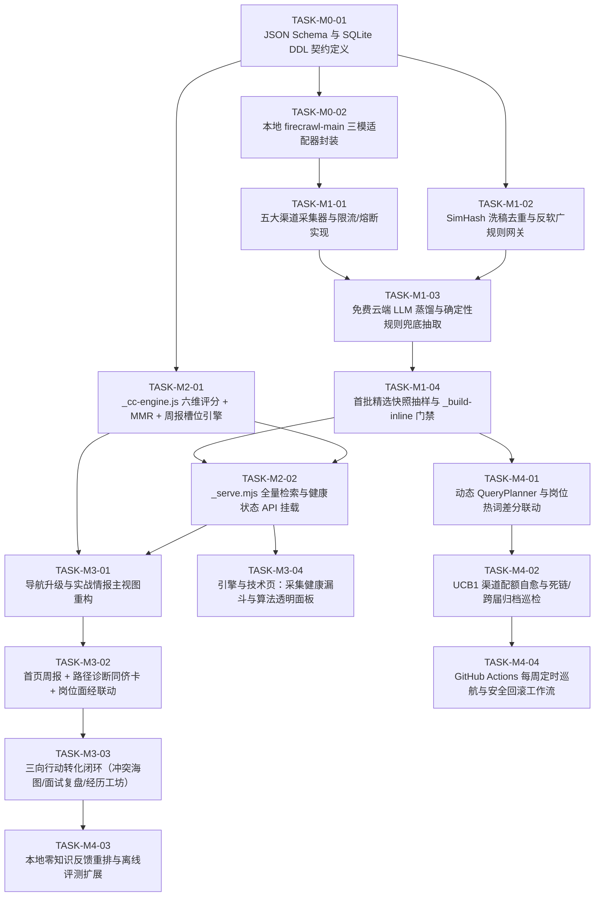

# Course Compass 实战经验情报采集与个性化推送系统 · 演进路线与任务拆解规格书（SDD Roadmap）

> **SDD 规范元数据（Spec Metadata）**
> - **Spec ID**：`CC-SDD-EXP-03-ROADMAP`
> - **版本**：`v1.0.0`
> - **状态**：`Draft · Ready for Review`
> - **关联规格书**：
>   - 需求规格书（PRD）：[`01-PRD-experience-intel.md`](./01-PRD-experience-intel.md)
>   - 技术与架构规格书：[`02-TECH-ARCH-experience-intel.md`](./02-TECH-ARCH-experience-intel.md)

---

## 1. 阶段演进里程碑总览（Milestones M0–M4）

采用 **契约先行（Schema-First）→ 采集蒸馏闭环 → 同构精排引擎 → 使用结构与闭环 UI → 无人值守自进化** 的五阶段渐进交付路线。每个里程碑结束均可独立通过回归测试并安全合入主分支，绝不破坏现有就业与四路径功能。

| 里程碑 | 阶段名称 | 核心交付目标 | 预计工作量 | 里程碑准出标准（Exit Gate） |
| :--- | :--- | :--- | :--- | :--- |
| **M0** | **契约锁定与 Firecrawl 底座联调** | 建立 `experience-intel.schema.json`、SQLite 表结构及本地 `firecrawl-main` 三模客户端适配器 | 1.5–2 天 | 契约单测全绿；本机 `firecrawl-local` / Cloud 搜索与单页抓取冒烟通过，受限页零对抗降级验证通过 |
| **M1** | **多源合规采集与四重反软广蒸馏** | 打通牛客、知乎专栏、小红书公开索引、GitHub 经验仓与 B站/高校源采集；落地 SimHash 去重、反软广拦截与云端免费 LLM/规则双模抽取 | 3–4 天 | 首轮种子库成功入库 $\ge 150$ 条高纯度真实经验卡；软广测试集拦截 Precision $\ge 95\%$；零 PII 残留 |
| **M2** | **同构推送算法 `intel-rank-2.0` 与服务端 API** | 在 `_cc-engine.js` 实现六维精排 + MMR 多样性重排 + 首页 4 槽位周报分配器；在 `_serve.mjs` 挂载 `/api/intel/*` 并接入静态内联快照构建 | 2–3 天 | 静态快照体积增量 `< 280KB`；不同起点测试画像 Top-5 显著分化且 100% 附带可解释 `why[]`；排序耗时 `< 25ms` |
| **M3** | **使用结构重构与“一核三嵌”行动闭环 UI** | 升级左侧导航结构；完成首页《每周航线周报》、`实战情报·经验库`、路径诊断内嵌同侪卡、岗位详情面经卡及三大一键转化按钮（进冲突海图/进面试题库/去经历工坊） | 3–4 天 | Playwright 端到端测试（`_employment-e2e.mjs` 扩展套件）全流程断言通过；零控制台报错与布局溢出 |
| **M4** | **四环自我更新、GitHub Actions 周巡与离线校准** | 落地动态 `QueryPlanner`、UCB1 渠道健康自愈、存量死链/跨届自动归档、本地零知识反馈学习及每周日 GitHub Actions 自动同步工作流 | 2–3 天 | 周度定时任务幂等试跑成功；故障回滚演练通过；扩展 `_employment-eval.mjs` 支持经验推荐 NDCG@5 评测 |

---

## 2. 研发任务依赖有向无环图（Executable Task DAG）

通过 SDD 数据契约（`TASK-M0-01`）解耦前后端：一旦 `M0` 契约锁定，**采集蒸馏管线（M1）** 与 **同构精排引擎（M2-A）** 可并行推进！

---

## 3. 原子任务拆解规格（Sharded Atomic Tasks）

### 阶段 M0：契约锁定与 Firecrawl 底座联调

#### `TASK-M0-01`：定义经验情报 JSON Schema 与 SQLite 存储契约
- **关联需求**：`CONST-02`, `CONST-04`, `REQ-CLN-02`
- **新增 / 修改文件**：
  - 新增 `experience-intel.schema.json`
  - 新增 `_experience-db.mjs`（封装 `_research/experiences.db` 的建表迁移、CRUD 与事务读写）
  - 新增 `_experience-contract-test.mjs`
- **实现要点**：严格约束 `trustTier`、`authorBaseline`、`mappedSkillIds`（与 `employment.schema.json` 的 83 项技能词表对齐校验）、`actionTask` 与 `citation`。
- **验收门禁**：运行 `node _experience-contract-test.mjs` 校验正例样本与非法脏数据反例（越界 `skillId`、缺失 `sourceUrl`、非法 `trustTier` 均须精准拦截），Exit Code `0`。

#### `TASK-M0-02`：封装对接 `E:\github_bag\firecrawl-main\firecrawl-main` 的三模客户端
- **关联需求**：`CONST-01`, `REQ-ING-01`, `REQ-ING-02`
- **新增 / 修改文件**：
  - 新增 `_firecrawl-client.mjs`
  - 新增 `_setup-firecrawl-local.ps1`（可选辅助脚本：检测或引导启动 `E:\github_bag\firecrawl-main\firecrawl-main\apps\local` 或 Docker 服务）
- **实现要点**：
  - 统一实现 `searchPages({ query, limit, tbs })` 与 `scrapePage({ url, onlyMainContent, maxAge, timeoutMs })`；
  - 自动按环境变量优先级路由：`FIRECRAWL_API_URL`（默认探测本机 `http://127.0.0.1:3002/health`）$\rightarrow$ `FIRECRAWL_API_KEY`（云端 v2 API）；
  - 内置域名级令牌桶限流器与 `401/403/429/blocked` 零对抗快速失败拦截器。
- **验收门禁**：Mock 单元测试覆盖正常返回、超时中断、`403/blocked` 触发冷却且不重试；本地联调公开页面返回干净 Markdown。

---

### 阶段 M1：多源合规采集与四重反软广蒸馏

#### `TASK-M1-01`：实现五大渠道发现与合规抓取适配器
- **关联需求**：`REQ-ING-01`, `REQ-ING-02`, `CONST-01`
- **前置依赖**：`TASK-M0-02`
- **新增 / 修改文件**：新增 `_experience-channels.mjs`
- **实现要点**：按技术规格书第 2.3 节实现 `nowcoder`、`zhihu`、`xiaohongshu`（Search-First + 公开页优雅降级）、`github_exp`、`bilibili_edu` 五个声明式渠道配置与 URL 白名单守卫。
- **验收门禁**：各渠道 URL 正则白名单与非允许路径（如私信页、登录页、用户设置页）拒绝单测 100% 通过。

#### `TASK-M1-02`：实现 URL 归一化、64-bit SimHash 洗稿去重与确定性反软广网关
- **关联需求**：`REQ-CLN-01`, `REQ-CLN-03`, `CONST-03`, `CONST-05`
- **前置依赖**：`TASK-M0-01`
- **新增 / 修改文件**：新增 `_experience-cleaner.mjs`
- **实现要点**：
  - 剥离全平台追踪参数生成 `canonicalUrl`；
  - 实现纯 JS 64-bit SimHash 与海明距离计算（阈值 $\le 3$ 自动归并 `alternateSources` 并累加 `corroborationCount`）；
  - 实现反软广硬黑名单正则矩阵与双层 PII 脱敏函数（兼容复用 `_employment-llm.mjs` 脱敏规则）。
- **验收门禁**：构造含 30 条典型卖课引流/扣1领资料软广 + 30 条真实保研/面经贴 + 5 组跨平台洗稿复本的基准集，单测验证软广拦截率 $\ge 95\%$、洗稿合并率 `100%`、PII 零残留。

#### `TASK-M1-03`：实现多源免费云网关蒸馏与零显存规则兜底抽取器
- **关联需求**：`REQ-CLN-02`, `CONST-04`
- **前置依赖**：`TASK-M1-01`, `TASK-M1-02`
- **新增 / 修改文件**：
  - 新增 `_experience-distiller.mjs`
  - 新增 `_crawl-experiences.mjs`（CLI 入口，支持 `--channels`、`--limit`、`--dry-run`）
- **实现要点**：
  - 调用 `_employment-llm.mjs` 的 `callCloudChat` 提取结构化字段，并执行严格后验校验（`mappedSkillIds` 合法性核验、原文依据核验、未披露背景强制置 `"unknown"`）；
  - 实现无 API Key 时的纯确定性抽取兜底 `extractExperienceDeterministic()`；
  - 计算客观指导纯度分 $Q_{\text{guide}}$。
- **验收门禁**：在开启云模型与强制关闭云模型（纯规则兜底）两种模式下运行 `--dry-run`，产出记录 100% 通过 `experience-intel.schema.json` 校验。

#### `TASK-M1-04`：打通精选快照导出与静态包体积预算守护
- **关联需求**：`CONST-04`, NFR 静态体积预算
- **前置依赖**：`TASK-M1-03`
- **新增 / 修改文件**：
  - 修改 [`_enrich-catalog.mjs`](../../_enrich-catalog.mjs)
  - 修改 [`_build-inline.mjs`](../../_build-inline.mjs)
- **实现要点**：按四路径与八方向均衡配额从 `_research/experiences.db` 导出 Top-300 精选经验至 `_cc-data.json`，并在 `_build-inline.mjs --check` 增加快照体积 `< 280KB` 与 Schema 一致性检查。
- **验收门禁**：`node _enrich-catalog.mjs && node _build-inline.mjs && node _build-inline.mjs --check` 全绿通过。

---

### 阶段 M2：同构推送算法 `intel-rank-2.0` 与服务端 API

#### `TASK-M2-01`：在 `_cc-engine.js` 实现六维精排、MMR 重排与周报 4 槽位分配器
- **关联需求**：`REQ-RNK-01`, `REQ-RNK-02`
- **前置依赖**：`TASK-M0-01`
- **新增 / 修改文件**：
  - 修改 [`_cc-engine.js`](../../_cc-engine.js)
  - 修改 [`_smoke.mjs`](../../_smoke.mjs)
- **实现要点**：
  - 导出 `CC.rankExperienceIntel(profile, paths, items, userPrefs, now)` 与 `CC.buildWeeklyDigest(rankedItems, paths)`；
  - 完整实现 $M_{\text{path}}, M_{\text{peer}}, M_{\text{gap}}, Q_{\text{guide}}, F_{\text{time}}, U_{\text{stage}}$ 六维计算、MMR 多样性重排（$\lambda = 0.72$）及精准 `why[]` 命中标签生成；
  - 兼容合并原有 16 条确定性规则情报，统一输出契约。
- **验收门禁**：在 `_smoke.mjs` 新增断言：（1）双非零实习画像 vs 科班有项目画像 Top-5 排序差异性断言；（2）同质面经 MMR 去重断言；（3）500 条规模下运行耗时 `< 25ms`。

#### `TASK-M2-02`：在 `_serve.mjs` 挂载全量经验检索、Feed 重排与渠道健康 API
- **关联需求**：`CONST-04`, 技术规格书第 7.1 节
- **前置依赖**：`TASK-M1-04`, `TASK-M2-01`
- **新增 / 修改文件**：
  - 新增 `_experience-api.mjs`
  - 修改 [`_serve.mjs`](../../_serve.mjs)
- **实现要点**：实现 `GET /api/intel/experiences`、`POST /api/intel/feed`、`GET /api/intel/sources/health` 及仅限 `127.0.0.1` 回环调用的 `POST /api/intel/crawl/trigger`，复用同源校验与速率限制。
- **验收门禁**：接口契约测试覆盖同源放行、跨域 `403` 拦截、非回环触发巡航 `403` 拦截及空库回退内联快照逻辑。

---

### 阶段 M3：使用结构重构与“一核三嵌”行动闭环 UI

#### `TASK-M3-01`：导航结构调整与「实战情报·经验库」主视图升级
- **关联需求**：`REQ-UX-01`, PRD 第 3.1 & 3.3 节
- **前置依赖**：`TASK-M2-01`, `TASK-M2-02`
- **新增 / 修改文件**：修改 [`index.html`](../../index.html)
- **实现要点**：
  - 左侧导航将 `定向情报` 上移至第二核心组「方向探索与规划」并升级为 `实战情报`；
  - 重构 `renderIntel()`：支持按分类（全部 / 面经真题 / 上岸复盘 / 项目破局 / 政策窗口 / 避坑指南）、渠道、同起点筛选及关键词检索；
  - 渲染标准化 7 锚点经验卡片（含作者起点对标条、多源印证标、展开态实操步骤与原帖跳转）。
- **验收门禁**：静态文件直开与 `node _serve.mjs` 双模式下渲染正常，响应式窄屏无横向滚动溢出。

#### `TASK-M3-02`：落地三大嵌入式触达位（首页周报 / 路径同侪卡 / 岗位详情面经栏）
- **关联需求**：PRD 第 3.2 节
- **前置依赖**：`TASK-M3-01`
- **新增 / 修改文件**：修改 [`index.html`](../../index.html)
- **实现要点**：
  - `renderDash()` 接入 4 槽位《每周航线周报》（支持一键已阅收起）；
  - `renderPaths()` 各路径诊断底部嵌入 2 条同起点前辈破局经验卡；
  - 岗位详情抽屉/视图新增「近期同族/同企真实面经与备战打法」折叠区。
- **验收门禁**：切换不同路径与点击任意岗位详情均能精准联动匹配卡片，空匹配时优雅隐藏不留空白框。

#### `TASK-M3-03`：打通三向行动转化闭环与冲突海图实时重算
- **关联需求**：`REQ-UX-01`
- **前置依赖**：`TASK-M3-02`
- **新增 / 修改文件**：
  - 修改 [`index.html`](../../index.html)
  - 修改 [`_employment-e2e.mjs`](../../_employment-e2e.mjs)
- **实现要点**：
  - 点击 `⚡ 采纳进本周行动`：将 `actionTask` 写入个人行动清单，累加预估工时并即时重算 `冲突海图` 超负荷预警；
  - 点击 `🎯 收入面试题库`：将卡片 `interviewQuestions[]` 追加入就业投递看板的面试复盘列表；
  - 点击 `🛠️ 去经历工坊参考`：携带改造提示跳转 `经历工坊`。
- **验收门禁**：在 `_employment-e2e.mjs` 新增无头浏览器端到端用例，完整走通“浏览经验卡 $\rightarrow$ 点击采纳行动 $\rightarrow$ 跳转冲突海图验证工时负荷更新 $\rightarrow$ 点击收入面试题库验证复盘页可见”。

#### `TASK-M3-04`：升级「引擎与技术」透明透视看板
- **关联需求**：PRD 第 3.2 节透明性要求
- **前置依赖**：`TASK-M2-02`
- **新增 / 修改文件**：修改 [`index.html`](../../index.html)（`renderTech()`）
- **实现要点**：可视化展示五大采集源健康状态、最近周巡漏斗（发现数 $\rightarrow$ 反软广拦截数 $\rightarrow$ 蒸馏入库数）、当前档案在 `intel-rank-2.0` 六维公式下的实时分项得分拆解表。
- **验收门禁**：页面无报错，静态模式下自动降级读取快照元数据展示。

---

### 阶段 M4：四环自我更新、GitHub Actions 周巡与离线校准

#### `TASK-M4-01`：实现动态 `QueryPlanner` 与岗位仓新兴技能差分感知
- **关联需求**：`REQ-UPD-01`
- **前置依赖**：`TASK-M1-04`
- **新增 / 修改文件**：新增 `_experience-query-planner.mjs`
- **实现要点**：结合自然月学制日历矩阵与 `_research/jobs.db` 近 14 天新增高频 `skillId` 自动合成当周各渠道检索 Query，并持久化至 `query_seeds` 表。
- **验收门禁**：单元测试输入不同月份（3月春招季 vs 9月秋招推免季）与模拟新兴技能爆发样本，验证生成的检索词精准切换。

#### `TASK-M4-02`：实现 UCB1 渠道配额自适应、死链复检与跨届自动归档
- **关联需求**：`REQ-UPD-02`
- **前置依赖**：`TASK-M4-01`
- **新增 / 修改文件**：修改 `_crawl-experiences.mjs`
- **实现要点**：
  - 按 UCB1 公式动态分配当周各渠道抓取上限；
  - 每次周巡抽检 Top-30 高曝光卡片（`maxAge: 0`）识别失效死链并标记 `source_removed`；
  - 自动检测过期毕业届别并转为 `archived_past_batch` 往届参考态。
- **验收门禁**：模拟渠道连续 `429` 与存量 `404` 死链，验证冷却熔断、配额转移与死链下架逻辑 100% 生效。

#### `TASK-M4-03`：落地本地零知识反馈自适应与 `_employment-eval.mjs` 评测扩展
- **关联需求**：`REQ-UPD-03`, NFR 推荐质量指标
- **前置依赖**：`TASK-M3-03`
- **新增 / 修改文件**：
  - 修改 [`index.html`](../../index.html)（`state.intelPrefs` 随本机 `AES-GCM` 账号保险箱同步加解密）
  - 修改 [`_employment-eval.mjs`](../../_employment-eval.mjs)（新增 `--intel-eval` 评测模式）
- **实现要点**：实现正负反馈即时更新 `tagWeights` 并触发无刷新重排；扩展离线评测脚本计算经验推荐 `NDCG@5` 与同起点匹配覆盖率。
- **验收门禁**：`node _employment-eval.mjs --self-test` 全绿通过；浏览器端点击“背景不符”后同类卡片排名立即下降且刷新页面后持久化保留。

#### `TASK-M4-04`：配置 GitHub Actions 每周自动巡航与安全回滚工作流
- **关联需求**：`CONST-04`, `REQ-ING-01`
- **前置依赖**：`TASK-M4-02`
- **新增 / 修改文件**：新增 `.github/workflows/weekly-intel-sync.yml`
- **实现要点**：每周日定时拉起增量采集与快照构建，串行执行全部五大自动检查门禁；仅当全套校验通过且存在实质内容变更时自动提交或发起 PR，失败自动丢弃工作区变更保留稳定基线。
- **验收门禁**：工作流 YAML 语法与本地模拟完整干跑（Dry-run）零异常通过。

---

## 4. 需求—架构—测试双向追溯矩阵（RTM）

| PRD 需求 ID | 需求简述 | 架构规格章节（`02-TECH-ARCH`） | 对应原子研发任务 | 自动化验证门禁 |
| :--- | :--- | :--- | :--- | :--- |
| `CONST-01` / `REQ-ING-02` | 零对抗合规采集与受限自动熔断 | §2.2, §2.3 | `TASK-M0-02`, `TASK-M1-01` | `_experience-contract-test.mjs`（限流与 403/429 不重试断言） |
| `CONST-02` | 事实与社区经验严格分级隔离 | §3.4, §4.2 | `TASK-M0-01`, `TASK-M3-01` | Schema 校验 + UI 免责声明可见性 E2E 断言 |
| `CONST-03` / `REQ-CLN-01` | 反软广引流拦截与防刷流限额 | §3.2, §5.3 | `TASK-M1-02`, `TASK-M2-01` | 反软广基准测试集（Precision $\ge 95\%$）+ 首页 4 槽位上限断言 |
| `CONST-04` | 静态站与本地全量双模兼容 + 零本地 GPU | §1.1, §2.1, §7.2 | `TASK-M1-03`, `TASK-M1-04`, `TASK-M2-02` | `_build-inline.mjs --check`（`< 280KB`）+ Zero-GPU `_smoke.mjs` |
| `CONST-05` | 双层 PII 脱敏与原文出处溯源 | §3.2, §4.2 | `TASK-M1-02`, `TASK-M1-03` | PII 注入扫描单测 + `citation.sourceUrl` 必填契约校验 |
| `REQ-CLN-02` / `REQ-CLN-03` | 结构化要素蒸馏、SimHash 去重与多源印证 | §3.1, §3.3, §3.4 | `TASK-M1-02`, `TASK-M1-03` | SimHash 近似去重单测 + 83 项合法 `skillId` 交叉校验 |
| `REQ-RNK-01` / `REQ-RNK-02` | 六维同侪+缺口精排、MMR 重排与可解释性 | §5.1, §5.2, §5.3 | `TASK-M2-01` | `_smoke.mjs` 多画像分化断言、MMR 去重断言、耗时 `< 25ms` 断言 |
| `REQ-UPD-01..03` | 动态检索词、UCB1 自愈、死链归档与反馈闭环 | §6.1 – §6.4 | `TASK-M4-01` – `TASK-M4-04` | `_employment-eval.mjs --self-test` + 状态转移单测 |
| `REQ-UX-01` | “一核三嵌”信息架构与三向行动转化闭环 | §1, §5.3 | `TASK-M3-01` – `TASK-M3-04` | `node _employment-e2e.mjs` 无头浏览器全链路回归 |

---

## 5. 风险识别与工程应对预案（Risk Matrix）

| 风险项 | 可能性 | 影响度 | 工程应对与兜底策略 |
| :--- | :---: | :---: | :--- |
| **小红书 / 知乎搜索收录波动或风控收紧** | 高 | 中 | 依托多渠道 UCB1 动态配额转移至牛客网、GitHub 开源经验仓、B站专栏与高校官网；任何单渠道产出降为 0 时系统仍保持高信噪比周报更新，绝不报错停摆。 |
| **软广话术变异绕过静态正则** | 中 | 高 | 双层防御：Stage B 正则拦截显性引流 + Stage C 大模型语义识别隐性软文（如暗捧某机构老师），并结合前端用户点击 `🚫 疑似软广` 实时本地拉黑与离线规则库迭代。 |
| **免费云端大模型高峰期 `429` 限流** | 中 | 低 | 周度批处理在夜间低峰期串行限速运行，复用 `_employment-llm.mjs` 跨平台三池容灾（魔搭 $\rightarrow$ 硅基流动 $\rightarrow$ 智谱），极端离线场景自动回退 `extractExperienceDeterministic` 纯规则抽取。 |
| **内联快照随周度累积导致 `index.html` 膨胀** | 高 | 中 | 实施“冷热分层”：全量历史无限沉淀在本地 `_research/experiences.db`，而内联至 `index.html` 的公开快照严格执行 **Top-300 淘汰制（Rolling Eviction）**，由 `_build-inline.mjs --check` 强锁 `< 280KB` 红线。 |
