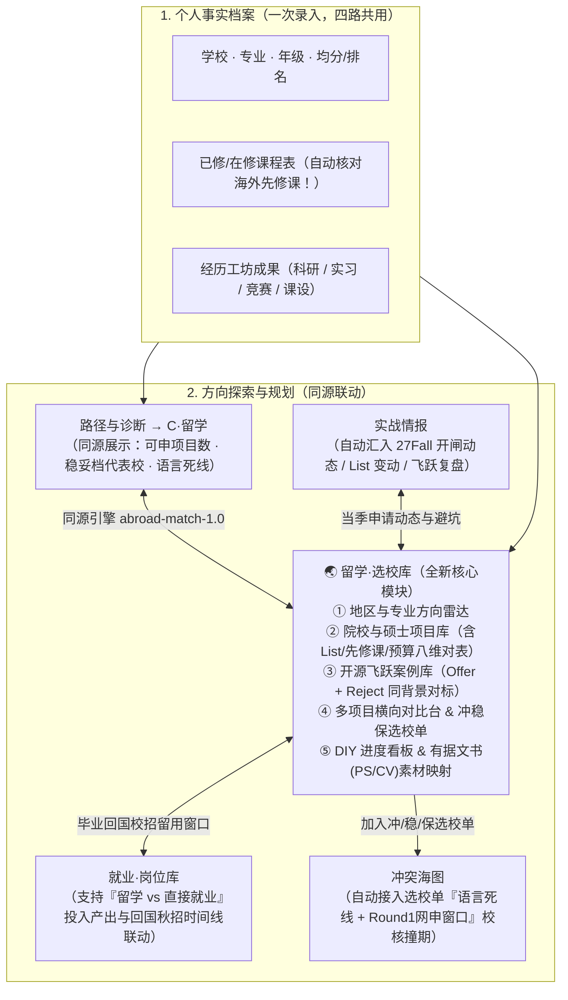

# Course Compass 留学·选校与开源案例库系统 · 产品需求规格说明书（PRD）

> **SDD 规范元数据（Spec Metadata）**
> - **Spec ID**：`CC-SDD-ABR-01-PRD`
> - **版本**：`v1.0.0`
> - **状态**：`Implemented & Verified (M0–M4 All Gates Green)`
> - **所属分支**：`feat/study-abroad-compass`（基于 `feat/experience-intel-crawler` @ `0051ecb`，复用本地 Firecrawl v2 采集底座）
> - **关联规格书**：
>   - 技术与架构设计规格书（合一）：[`02-TECH-ARCH-study-abroad.md`](./02-TECH-ARCH-study-abroad.md)
>   - 演进路线与任务拆解规格书：[`03-ROADMAP-study-abroad.md`](./03-ROADMAP-study-abroad.md)

---

## 1. 产品经理深度调研：竞品拆解、开源生态与真实痛点

### 1.1 Course Compass 现存留学模块短板诊断

在当前产品中，「就业」路径已拥有独立的商业级模块 `就业·岗位库`（682 条精选岗位 + 31.8 万仓 + 八维确定性匹配 + 有据简历 + 投递看板），而作为四大核心路径之一的 **「C · 留学（`liuxue`）」** 仅在 [`index.html`](../../../index.html) 的 `路径与诊断` 中保留了一段极简静态判断（`gpa >= 85 达 G5 参考线；gpa >= 80 港校可冲`），存在四大核心缺失：
1. **无院校与专业项目库**：学生无法查看具体的海外硕士/博士项目（学制、学费、课程设置、语言总分与小分、是否必须带语言申请、各轮次截止日）。
2. **无院校 List 与先修课核验**：忽略了英国名校严格的本科院校 List 卡校规则，也忽略了欧陆与港新跨专业申请最致命的**先修课学分（Prerequisites）**审核——而学生明明已经在「建立档案」录入了完整课表！
3. **无真实录取/被拒案例对标**：学生不清楚与自己“同院校层次 + 同均分区间 + 相似软背景”的学长学姐究竟录了哪里、又在哪些项目上踩雷被拒。
4. **无 DIY 选校清单与时间线联动**：选定的目标项目无法自动拆解出语言死线、文书节点并同步进《冲突海图》与保研/考研/秋招进行撞期核算。

---

### 1.2 主流留学产品与开源/社区渠道深度对比调研

作为产品经理，我们对市面上主流商业留学 App、垂直论坛及开源项目进行了系统拆解：

| 平台 / 渠道类型 | 代表产品 / 来源 | 核心优势（值得借鉴的设计） | 突出痛点与商业局限（我们的破局点） | 数据形态与合规采集可行性 |
| :--- | :--- | :--- | :--- | :--- |
| **商业选校与案例 App** | **指南者留学（CompassEdu）**、选校帝 | **「查院校 · 选专业 · 看案例」三支柱极清晰**：专业页拆解学制/学费/语言/Deadline/Curriculum；支持按本科背景+GPA+专业检索案例；输出冲/稳/保三档定位。 | 1. **重度私域销售转化**：核心评估与深层功能诱导留手机号加顾问微信； 2. **返佣导向偏科**：重推有佣金的英澳港新授课硕，弱化欧陆免学费名校（TUM/ETH/TU Delft）、港校 MPhil 及 DIY 路径； 3. **只报喜不报忧**：几乎全展示成功 Offer，缺乏 Reject（拒信）样本对照； 4. **课表盲区**：无法核对学生已修课是否满足项目先修课要求。 | 商业闭源受版权保护（**严禁直接盗爬商业竞品私有库**；我们借鉴其优秀的产品结构，用**高校官网一手数据 + 开源/公开案例**构建自主合规底座）。 |
| **GitHub 高校开源《飞跃手册》与公开数据集** | 各高校飞跃手册（如 `SUSTechapplication`、`THU-feiyue` 等 MIT/开放仓库）、`Hipo/university-domains`、`OpenAlex` CC0 机构库 | **100% 零中介注水、真实度天花板**：由上岸学长自发开源维护，完整记录三维硬背景、科研实习、最终拿到哪些 Offer **以及被哪些学校 Reject**，附带极其真诚的 DIY 避坑心路。 | 分散在数十个独立 GitHub 仓库 Markdown/PDF 中，格式不统一，非计算机专业同学极难检索；且 GitHub 泛搜存在无关/违规仓库混入风险。 | **极高（主力开源底座）**：通过白名单校验仓库 + 开源协议核验 + Firecrawl / GitHub API 提取清洗，天然结构化。 |
| **海外与垂直公开录取榜** | **The GradCafe**（公开录取结果库）、公开 Google Sheets / GitHub Offer 汇总表 | 样本量大，精确到提交日期（Applied Date）、面试日期（Interview）与结果揭晓日（Decision Date），同时包含 Admitted 与 Rejected。 | 英文缩写多、北美比重高，缺乏针对中国大陆本科 985/211/双非百分制均分与港新英欧混申的本土化解读。 | 公开可读页面，遵守 `robots.txt` 与限流下可通过 Firecrawl 提取结构化记录。 |
| **国内泛社交经验社区** | **小红书、知乎**（`26Fall/27Fall` Timeline 播报贴、DIY 复盘长文） | **时效性极强**：当季哪所英国大学突然改了 List、哪个港校专业提前发面邀、双非低分捡漏新开专业，小红书/知乎往往第一时间出现真实播报。 | **留学中介软广重灾区**（“均分75保录G5”、“评论区扣1测选校”实为高价保录骗局或焦虑营销）；单帖碎片化严重。 | 采用已验证的 **Firecrawl `/v2/search` 公开索引发现 + 四重反软广/反保录黑产网关** 每周增量提纯。 |

---

### 1.3 跨地区留学游戏规则差异矩阵（驱动产品底层建模）

为什么不能用“一条均分线走天下”？因为主流留学地区的核心录取逻辑截然不同，产品必须在数据结构与匹配引擎层原生建模这五大差异：

| 决策维度 | 英国（UK） | 中国香港 & 新加坡（HK & SG） | 欧洲大陆（德 / 荷 / 瑞 / 北欧 / 法） | 美国 / 加拿大 / 澳洲 |
| :--- | :--- | :--- | :--- | :--- |
| **院校背景（List 卡校）** | **极严格显性 List**：按陆本软科/自定义 Tier 分档，同专业对 985/211 可能要 `80%`，双非要 `85%–88%` 或不在 List 直接秒拒 | **强隐性偏好**：无统一公开名单，但热门商科/CS 极看重 985/211/双一流及财经政法强校；双非需高均分+强实习/雅思考出突围 | **不卡双非出身、重教育部认证**：公立名校极少歧视双非（需 APS 审核或学位认证），对高均分双非理工科极友好 | **美加看重综合科研/GPA算法，澳洲公开分档清晰、跨申包容度高** |
| **先修课（Prerequisites）** | 商科泛管包容跨申；CS/DS/金融工程要求定量与编程课 | 商分/金工/CS 严查微积分、线代、概率统计与编程背景 | **绝对硬门槛（ECTS 学分核对）**：逐门核对本科课程描述与学分匹配度，缺先修课学分即使均分 92 也直接拒 | 美硕跨申有专门桥梁项目（如 Align/MCIT），普通项目查核心先修课 |
| **语言递交机制** | **绝大多数支持「无语言先递交」**，先拿 Conditional Offer 再补雅思或配语言班（IC/LSE 部分专业除外） | **绝大多数要求递交时带合格雅思/托福**（极少数接受六级），无语言通常不审理 | **硬死线前必须带达标语言（含小分）**，基本无语言班机制 | 美加网申须带托福/雅思；澳洲支持无语言先拿 Con-Offer |
| **录取节奏** | **Rolling 滚动先到先得**（9–10月开闸，录满即止） | **提前批 + 轮次 Rolling**（商科 9–10 月 Round 1 黄金期） | **固定截止日统一审理**（多在 11 月–次年 3 月，早交不抢跑但材料要求严） | 美加固定 Deadline（12月–1月为主）；澳洲滚动审理极快 |
| **年总预算（学费+生活费）** | 约 `35–55 万 RMB/年`（1年制为主） | 约 `30–48 万 RMB/年`（1–1.5年制） | **高性价比 `12–25 万 RMB/年`**（德/法/北欧公立免学费或低学费，2年制） | 美国 `45–75 万 RMB/年`；澳洲 `35–50 万 RMB/年` |

---

## 2. 产品愿景与 SDD 宪法红线（Constitutional Rules）

### 2.1 产品核心定位

打造 **「零中介骚扰 · 课表级先修核验 · Offer/Rej 双样本开源对标 · 多路径时间协同」的全自助留学选校与申请驾驶舱**：
- 让考虑留学的同学（包括正在对比「保研 + 留学双保险」或「就业 + 留学对比」的同学）**不用重复填表**，直接用已有个人事实档案看清：**哪些地区和项目不卡我的学校、我的课表满足哪些先修课、我的预算够去哪里、同背景前辈真实录了哪又挂了哪、如果决定申，哪天必须考出雅思、哪天必须写完文书**。

### 2.2 SDD 宪法红线（Constitutional Constraints）

> [!IMPORTANT]
> 所有数据采集、算法计算与界面文案必须严格遵守以下 6 条系统宪法：

- **`CONST-ABR-01`（数据合规与严禁盗爬商业竞品红线）**：**严禁抓取指南者留学等商业机构的受版权保护私有数据库或绕过任何登录/反爬限制**。院校与项目客观参数（学费、学制、语言线、截止日、课程设置）必须源自 **`A_OFFICIAL`（高校官网公开 Programme 页面 + OpenAlex CC0 / Hipo MIT 开源高校库）**；申请案例必须源自 **开源协议允许或公开可读的 GitHub 飞跃手册、公开录取统计表及脱敏搜索摘要（`B_CASE`）**，严格遵守 `robots.txt`。
- **`CONST-ABR-02`（开源仓库白名单与内容安全守卫红线）**：针对 GitHub 等开源平台检索可能混入非学术/政治/违规仓库的客观风险，采集管线必须执行 **「已核验高校飞跃仓库注册表（Verified Registry）+ 许可证校验 + 留学领域相关性与内容安全双重过滤」**，非留学申请领域的仓库或文件一律物理拒止。
- **`CONST-ABR-03`（反「保录取」黑产与零留资骚扰红线）**：入库前强制拦截一切“低分保录 G5/藤校”、“内推免雅思直录”、“评论区扣1领选校表”等留学黑产与中介引流软广；产品全站**严禁设置任何收集手机号/微信号的留资门槛弹窗**。
- **`CONST-ABR-04`（Offer 与 Reject 双样本诚实对标红线）**：案例库必须同时支持收录与展示 `Offer（录取）` 与 `Reject（被拒）` 案例；选校引擎严禁输出伪精确的“AI 预测录取概率 78.4%”，统一输出可追溯证据的 **资格四态（`PASS / CONDITIONAL / FAIL / UNKNOWN`）+ 选校梯度三档（`冲刺 Reach / 稳妥 Match / 保底 Safety`）**，并附带「以目标院校当年官网最新章程为准」免责声明。
- **`CONST-ABR-05`（事实一次录入与多路径无感继承红线）**：自动继承「建立档案」中的学校、专业、年级、均分、排名、已修课程与「经历工坊」成果；留学专属补充项（目标地区偏好、年预算区间、当前语言/标化状态）采用**渐进式轻量抽屉/顶栏配置**，未填时保持开放浏览与诚实 `CONDITIONAL/UNKNOWN` 提示，绝不强制拦截浏览。
- **`CONST-ABR-06`（静态 + 本地双模运行与零本地显存红线）**：精选高频院校项目与真实飞跃案例内联至 `_cc-data.json`（增量严格受控），确保 GitHub Pages 纯静态版即开即用；本地 `node _serve.mjs` 连接 `_research/abroad.db` 全量 SQLite 库与免费云端大模型文书/选校副驾，保持 **Zero-GPU 零本地显存占用**。

### 2.3 明确不做（Out of Scope）

1. **不做留学中介签约撮合、付费文书代写或成绩单/背景造假包装**。
2. **不做境外高校网申系统（ApplyWeb / UCAS）自动代填表提交机器人**（网申账号涉及学生个人护照与缴费隐私，必须由本人亲自在官网提交）。
3. **首期聚焦研究生申请（授课型硕士 Master Taught、研究型硕士 MPhil/Master by Research 及直博 PhD 入口）**，暂不覆盖低龄高中或本科 UCAS/CommonApp 申请。

---

## 3. 全局用户体验与信息架构设计（UX & Information Architecture）

### 3.1 模块在 Course Compass 全局导航中的位置与联动闭环

将全新的 **「留学·选校库」（`data-module="abroad"`）** 置于左侧导航第二核心组「方向探索与规划」中，与 `就业·岗位库` 形成双子星对称结构，并与全站上下游无缝咬合：

### 3.2 「留学·选校库」内部五维一体极致交互设计

对标并超越指南者留学的三支柱，采用 **顶部紧凑子导航（`选校概览与项目库` | `真实案例库 (Offer/Rej)` | `对比台 (N)` | `我的选校单与DIY看板` | `文书弹药库`）**，零冗余横幅，首屏直达核心价值：

1. **首屏顶栏 ·「已继承个人档案 + 3 项留学轻量偏好条」**：
   - 自动展示已继承的 `[学校 · 专业 · 均分 XX · 已修课程 N 门 · 成果 M 段]`；
   - 提供行内即点即改的 3 个轻量筛选芯片（无需跳页填表）：
     - **意向地区（多选）**：`中国香港`、`新加坡`、`英国`、`欧陆（德/荷/瑞/北欧）`、`美加`、`澳新/日本`
     - **年度总预算**：`不限`、`≤20万/年（高性价比公立/奖学金）`、`20–35万/年`、`35–50万/年`、`50万+/年`
     - **当前语言状态**：`暂未出分（看可无雅先申或来得及考的）`、`雅思 6.0 / 6.5 / 7.0+`、`托福 80 / 90 / 100+`、`六级 CET-6 450+`（含单项最低小分可选填）

2. **视图一 · 院校与项目库（八维确定性对表 + 先修课自动审计）**：
   - **方向聚合先导卡**：按 `计算机与AI`、`数据科学与商业分析`、`电子电气与机械自动化`、`金融经济与管理`、`传媒教育与人文社科` 五大申请赛道聚合，卡片展示符合预算且无硬门槛阻断的项目数。
   - **项目卡片与详情页**：
     - 直观呈现：**QS/学科参考位次**、**学制与年总花费（原币种 + 折算 RMB）**、**语言要求徽章**（如 `IELTS 6.5(6.0) · 可无雅先申拿Con` vs `IELTS 7.0(6.5) · 递交必带语言`）、**List 准入状态**（`✓ 本校在认可梯度（要求均分 ≥82）` / `⚠️ 卡院校梯度`）、**先修课核对条**（如 `✓ 已修《高等数学》《线性代数》《Python》满足定量先修要求` 或 `🧩 缺 1 门统计类课程`）。
     - **SVG 三栏匹配溯源图**：复用并升级就业模块广受好评的可追溯图谱——左栏 `我的院校/均分/课表/经历事实` → 中栏 `项目八维准入核验（List/GPA/先修课/语言/标化/软背景/预算/轮次）` → 右栏 `高校官网 Entry Requirements 原文引文与直达链接`。

3. **视图二 · 开源飞跃与公开案例库（Offer + Reject 双样本防焦虑对标）**：
   - 支持一键开启 **「👤 只看与我同梯度 + 均分 ±3 分内的相似前辈案例」**；
   - 同时展示 **🟢 录取样本（Offer / Con-Offer）** 与 **🔴 拒信警示样本（Reject / Waiting List）**，每张案例卡清晰列出：`本科背景（如 双非一本 · 软件工程 · 均分 84.5）`、`标化（IELTS 6.5 / 无GRE）`、`核心软背景（1段中小厂实习 + 1项省级大创）`、`递交批次（26Fall R1 10月递交 → 12月拿 Offer）`、`关键胜负手/被拒原因提炼` 以及 `开源出处链接（如某高校飞跃手册 / GradCafe / 社区公开记录）`。

4. **视图三 · 多项目同屏横向对比台 + AI 混申策略参谋**：
   - 勾选 2–4 个跨国/跨地区项目（例如对比 *港中文信息工程（1年·36万·早申卷）* vs *曼彻斯特大学 ACS（1年·42万·可无雅先申）* vs *代尔夫特理工 CS（2年·22万·严查先修课）*），一表对齐**总花费、卡 List 严格度、先修课缺口、语言死线、毕业工签与回国秋招应届生身份衔接窗口**，并可调用免费云端大模型副驾生成中立的混申先后顺序建议。

5. **视图四 ·「我的冲/稳/保选校单」与 DIY 全流程进度看板**：
   - 加入选校单的项目自动按 `冲刺 Reach / 稳妥 Match / 保底 Safety` 分组（支持学生手动调整档位），并在结构失衡时给出温和提醒（如 *“当前选校单全部为冲刺档且均需带语言递交，建议至少补充 1–2 个稳妥/保底或可无雅先申项目对冲风险”*）。
   - 六阶段 DIY 状态流转看板：`📋 选校定项` → `📝 文书与推荐信准备` → `🗣️ 语言备考中` → `🚀 已网申递交` → `🎉 收到 Con/Uncon Offer` → `🏛️ 留位费与签证/复盘`。
   - **一键同步至《冲突海图》**：选校单内项目的 `最晚语言出分日` 与 `首轮网申截止日` 自动作为里程碑写入全局行动清单与《冲突海图》！

6. **视图五 · 有据文书（SOP / PS / Academic CV）弹药库**：
   - 严守真实性底线：读取用户在「建立档案」的高分专业课与「经历工坊」已核验的科研/课设/实习记录，针对目标项目的 `Core Modules（核心课程模块）` 生成中英双语对照的 **「动机逻辑链 + 经历证据段落草稿」**，缺失量化实验数据处显式标出 `[待补充实测数据]`，支持一键导出 Markdown 供本人润色定稿。

---

## 4. 功能需求规格与验收标准（Functional Requirements）

### 4.1 双轨合规数据采集与案例库构建（Ingestion & Case DB）

- **`REQ-ABR-01` 高校与硕士项目双源权威构建（OpenAlex/Hipo + Firecrawl 官网核验）**
  - **描述**：系统通过 OpenAlex CC0 开放机构接口与 Hipo MIT 大学域名库构建基础院校底座，并通过本地 Firecrawl v2 引擎定时抓取目标高校官网公开的 Postgraduate Programme 页面，提取学制、学费、语言总分与小分、GRE/GMAT 要求、先修课描述与申请截止轮次。
  - **验收标准（Given / When / Then）**：
    - *Given* 配置的目标院校官方项目 URL 列表；
    - *When* 运行留学项目同步管线；
    - *Then* 每条入库项目必须具备合法的高校官方域名 `officialUrl`、快照核验日期 `verifiedAt` 与原文引文片段 `requirementSnippets`，未在官网明示的字段（如未公开具体 List 分数）严格置为 `null` 或 `unknown`，绝不臆造。

- **`REQ-ABR-02` 开源飞跃手册与社区动态案例采集（含安全白名单与反软广网关）**
  - **描述**：系统从经白名单核验的 GitHub 高校开源飞跃手册仓库、公开录取统计源及 Firecrawl 搜索发现的知乎/小红书当季时间线摘要中提取匿名化申请案例（含 Offer 与 Reject），自动过滤非留学仓库与中介“保录取/私信领表”软广。
  - **验收标准**：
    - *Given* 混合了合法高校飞跃手册 Markdown、非相关/违规 GitHub 仓库以及“均分72保录G5私信我”中介软广的输入集；
    - *When* 执行 `_crawl-abroad-cases.mjs` 清洗蒸馏管线；
    - *Then* 非白名单/非留学主题内容与保录黑产软广拦截率 $\ge 98\%$；入库案例 100% 剥离姓名、学号、联系方式等 PII，且完整保留 `outcome`（`offer` / `conditional_offer` / `waitlist` / `reject`）与可追溯出处。

### 4.2 八维确定性选校匹配与案例对标引擎（Matching & Benchmarking）

- **`REQ-ABR-03` 八维确定性选校引擎（`abroad-match-1.0`）与先修课自动核对**
  - **描述**：综合「院校梯度与 List 准入、均分/GPA 竞争力、已修课表—先修课匹配度、语言总分与小分就绪度、GRE/GMAT 匹配、科研/实习软背景契合度、年度总预算匹配、申请轮次窗口」八个维度进行毫秒级确定性评分，并输出 `冲刺 Reach / 稳妥 Match / 保底 Safety` 三档定位及同源摘要（供 `路径与诊断 → C·留学` 直接复用）。
  - **验收标准**：
    - *Given* 一名「双非一本 · 汉语言文学 · 均分 86 · 未修高等数学与编程课」的学生画像；
    - *When* 对全库留学项目执行匹配；
    - *Then* 强卡 985/211 List 的英国项目或要求严格数学/编程 ECTS 先修课的欧陆 CS 项目准确判定为 `FAIL`（并明确列出阻断原因：`不在院校认可名单` 或 `缺少先修课：微积分/编程基础`）；而接受跨专业申请的港英传媒/教育项目及包容度高的项目准确进入 `Match / Reach`，且 `路径与诊断 → C·留学` 与 `留学·选校库` 首屏核心指标 100% 一致。

- **`REQ-ABR-04` 同背景 Offer / Reject 镜像案例相似度检索（`case-sim-1.0`）**
  - **描述**：在项目详情页与案例库中，按本科院校梯度距离、专业大类匹配度、均分差值（$|\Delta \text{GPA}|$）、标化与软背景重合度计算案例相似度，同时召回最相似的成功录取案例与被拒警示案例。
  - **验收标准**：
    - *Given* 用户查看某一热门硕士项目或开启「对标相似背景案例」；
    - *When* 库内存在同梯度录取与被拒样本；
    - *Then* 按相似度降序展示相似背景案例，明确区分绿色 `Offer` 与红色 `Reject` 标签，绝不隐藏拒信样本。

### 4.3 DIY 闭环工具链与全局时间协同（Workflow & Conflict Sync）

- **`REQ-ABR-05` 冲/稳/保选校组合风险诊断与《冲突海图》自动写回**
  - **描述**：学生将项目加入「我的选校单」后，系统实时检查梯度分布合理性，并根据各项目的语言提交机制（必带语言 vs 可后补 Con-Offer）与网申截止日自动生成里程碑任务同步至全局行动清单与《冲突海图》。
  - **验收标准**：
    - *Given* 学生同时勾选了「保研 + 留学」或「就业 + 留学」，并将 1 个 10 月中截止 Round 1 的港新项目加入选校单；
    - *When* 切换至 `冲突海图` 与 `路径与诊断`；
    - *Then* 全局行动清单自动出现该项目的文书与网申节点，且《冲突海图》准确展示暑假文书准备期与 9–10 月九推/秋招笔面试的时间排布关系。

- **`REQ-ABR-06` 基于已核验档案的有据文书（SOP/CV）素材映射**
  - **描述**：按目标项目的课程模块（Core Modules）与培养导向（学术型 vs 实践型），将学生本人确认过的课程与经历工坊成果映射为结构化文书大纲要点，严禁无中生有编造科研或实习细节。
  - **验收标准**：
    - *Given* 学生档案含 1 段未补充量化指标的课设与 1 段已确认实习；
    - *When* 在目标留学项目页点击「生成有据文书素材提纲」；
    - *Then* 生成的每条素材均绑定真实课程或成果 `evidenceId`，缺失指标处严格保留 `[待补充实测数据]` 占位符，支持导出 `.md` 文档。

---

## 5. 非功能性需求与核心质量指标（NFRs & KPIs）

| 指标维度 | 规格目标 | 验证门禁 |
| :--- | :--- | :--- |
| **前端计算延迟** | 对 200+ 精选留学项目与 300+ 案例执行八维匹配 + 案例相似度排序耗时 `P95 < 30ms` | `_smoke.mjs` 基准测试断言 |
| **内联静态包增量预算** | 内联至 `index.html` 的精选留学项目与飞跃案例快照（`studyAbroad` 字段）增量严格控制在 `< 320 KB` | `_build-inline.mjs --check` 体积红线校验 |
| **先修课与 List 核验准确率** | 标准测试画像集（985理工 / 211经管 / 双非文科 / 双非转码）硬门槛判定准确率 `100%`，零幻觉放行 | `_abroad-contract-test.mjs` 契约单测 |
| **反黑产与内容安全拦截率** | “保录取/免雅思内推”中介软广及非留学违规开源内容拦截率 `>= 98%`，PII 零泄露 | 清洗管线基准测试集断言 |
