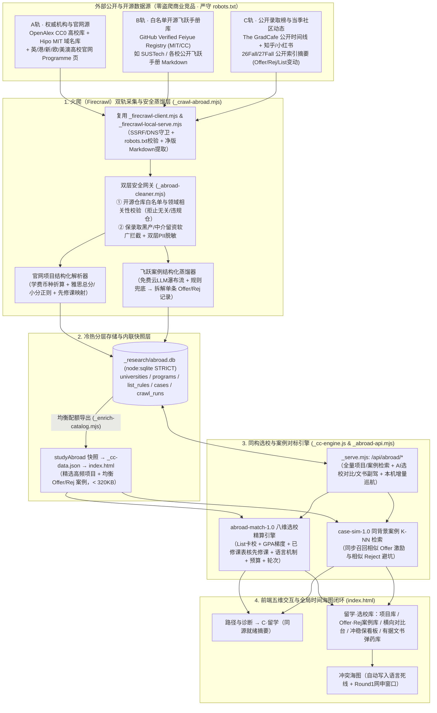

# Course Compass 留学·选校与开源案例库系统 · 技术与架构设计规格说明书

> **SDD 规范元数据（Spec Metadata）**
> - **Spec ID**：`CC-SDD-ABR-02-TECH-ARCH`
> - **版本**：`v1.0.0`（技术规格与系统架构合一文档）
> - **状态**：`Implemented & Verified (M0–M4 All Gates Green)`
> - **上游需求规格**：[`01-PRD-study-abroad.md`](./01-PRD-study-abroad.md)
> - **复用底层资产**：
>   - 火爬本地引擎与客户端：[`_firecrawl-local-serve.mjs`](../../../_firecrawl-local-serve.mjs)、[`_firecrawl-client.mjs`](../../../_firecrawl-client.mjs)
>   - 多源纯免费云端大模型瀑布流：[`_employment-llm.mjs`](../../../_employment-llm.mjs)（ModelScope `Qwen/Qwen3.8-27B` → 硅基流动 → 智谱 `glm-4.7-flash` → 零显存确定性兜底）
>   - 同构核心计算引擎：[`_cc-engine.js`](../../../_cc-engine.js)

---

## 1. 总体系统架构设计（System Architecture）

整体延续 Course Compass **「离线多源合规采集与结构化蒸馏 · 线上同构毫秒级确定性精算 · 静态 GitHub Pages 与本地 SQLite 全量服务双模一致」** 的架构范式，横向扩展出与就业模块完全对称的留学子系统：



---

## 2. 基于火爬（Firecrawl）的多源数据采集与安全蒸馏设计

### 2.1 三类数据源的精准采集路由策略

复用 [`_firecrawl-local-serve.mjs`](../../../_firecrawl-local-serve.mjs) 与 [`_firecrawl-client.mjs`](../../../_firecrawl-client.mjs)，按数据源性质实施严格分流：

| 源轨道 | 具体目标源 | 采集方式与 Firecrawl 原语 | 信任等级 | 更新频次与合规策略 |
| :--- | :--- | :--- | :---: | :--- |
| **Track A1 · 全球院校权威元数据** | **OpenAlex Institutions API** (`api.openalex.org/institutions`, CC0 协议) + **Hipo University Domains** (`MIT` 协议) | 原生 HTTPS JSON 拉取，获取标准院校英文名、国家/地区码、官方主页根域名（如 `hku.hk`, `imperial.ac.uk`, `tum.de`）、学科活跃度 | `A_OFFICIAL` | 每季度校验一次；仅信任匹配官方根域名的项目落地页 |
| **Track A2 · 高校官网硕士项目页** | 英（`.ac.uk`）、港（`.edu.hk`）、新（`.edu.sg`）、欧陆（`tum.de`, `tudelft.nl`, `ethz.ch`, `kth.se`）、美澳公开 Postgraduate Prospectus 页 | **`firecrawl.scrapePage({ onlyMainContent: true })`**：遵守 `robots.txt`（速率 `1 req / 4s`），提取 Entry Requirements、Tuition Fees、Application Deadlines 与 Core Modules 原文片段 | `A_OFFICIAL` | 申请季（9–3月）每两周巡检截止日状态，非申请季每月巡检 |
| **Track B1 · 高校开源《飞跃手册》库** | **显式白名单注册表（`VERIFIED_FEIYUE_REPOS`）** 内的高校学生开源飞跃手册仓库（如南科大 `SUSTechapplication` 等开放许可仓库中的申请总结 `.md` 章节） | GitHub Tree/Raw 读取或 `firecrawl.scrapePage`；通过 `ETag / sha` 增量拉取新增年份章节，将一篇长总结拆解为多条独立项目投递结果（例如同一位同学申了 6 个项目：4 Offer + 2 Reject，拆成 6 条细粒度案例！） | `B_CASE` | 每月增量同步；**严禁脱离白名单盲扫未审核仓库**（防范非学术违规内容混入） |
| **Track B2 · 公开录取榜与社交社区动态** | **The GradCafe** 公开结果页 + **知乎专栏 / 小红书** 公开搜索索引（如 `"27Fall" ("港大" OR "曼大" OR "TUM") ("Offer" OR "拒信" OR "Timeline") BG`） | 对 `robots.txt` 允许的公开榜走 `scrapePage`；对小红书/知乎严格走 **`firecrawl.searchPages` 索引摘要提取（`snippet_only`）**，同时生成案例记录与 `liuxue` 赛道实战情报卡 | `B_CASE` | 每周日随周度巡航自动执行 |

### 2.2 双层安全清洗网关（`_abroad-cleaner.mjs`）

1. **第一层 · 领域相关性与内容安全白名单守卫（Domain & Safety Gate）**：
   - 校验文本必须包含显式留学实体词（目标院校/学位 `MSc/MA/MEng/MPhil/MS/PhD`、成绩标化 `GPA/均分/IELTS/TOEFL/GRE/GMAT`、申请动作 `Offer/AD/Rej/Conditional/网申/文书` 至少命中两类），并排除任何非教育类敏感违规词，确保开源文本 100% 纯净聚焦学术深造。
2. **第二层 · 反「保录取/中介引流」黑产拦截器（Anti-Agency-Scam Gate）**：
   - 一票否决正则库：
     - 保录诈骗：`/(?:保录取|免雅思直录|低分保录|内推名额直录|教授内推保过|不出分拿offer|操作成绩单|背景挂靠)/i`
     - 私域截流：`/(?:评论区|后台|主页|私信).{0,10}(?:扣|留|发|领).{0,10}(?:选校表|选校评估|院校list|定位报告|免费规划)/i`
     - 机构软文：`/(?:签约了.{0,8}留学|强烈安利.{0,6}顾问老师|加老师vx评估)/i`
3. **第三层 · 本科背景标准化与双层 PII 脱敏**：
   - 自动将案例中出现的“末流985 / 中九 / 双非财经一本 / 211理工”等口语化背景归一化为标准枚举 `undergradTier`，同时剥离具体个人姓名、微信号、邮箱、导师私人联系方式与精确排名名次（仅保留百分比分位桶如 `top10%`、`10%-25%`）。

---

## 3. 数据模型与契约定义（SQLite & JSON Schema Contracts）

### 3.1 SQLite 持久化数据库 Schema（`_research/abroad.db`）

采用 Node.js `>= 22.5.0` 内置 `node:sqlite` `STRICT` 模式建模核心六表：

```sql
-- 1. 海外与港澳台院校主表（对齐 OpenAlex / 官方域名）
CREATE TABLE IF NOT EXISTS abroad_universities (
  id                TEXT PRIMARY KEY NOT NULL, -- univ_hku | univ_ucl | univ_tum | univ_nus
  name_zh           TEXT NOT NULL,
  name_en           TEXT NOT NULL,
  region            TEXT NOT NULL CHECK (region IN ('hk', 'sg', 'uk', 'eu', 'us_ca', 'au_nz', 'jp_kr')),
  country_code      TEXT NOT NULL,             -- HK | SG | GB | DE | NL | CH | US | AU | JP
  city              TEXT NOT NULL,
  official_domain   TEXT NOT NULL,             -- hku.hk | ucl.ac.uk | tum.de
  openalex_id       TEXT,
  qs_band           TEXT,                      -- Top10 | Top30 | Top50 | Top100 | Top200 | Specialized
  psw_visa_policy   TEXT NOT NULL,             -- 如 "IANG 2年无条件逗留签" / "荷兰 Zoekjaar 1年找工作签"
  list_strictness   TEXT NOT NULL CHECK (list_strictness IN ('strict_list', 'tier_preferred', 'degree_accredited_only'))
) STRICT;

-- 2. 硕士/直博细分专业项目表（对标并超越指南者专业库颗粒度）
CREATE TABLE IF NOT EXISTS abroad_programs (
  id                      TEXT PRIMARY KEY NOT NULL, -- prog_hku_msc_cs | prog_tum_msc_ce
  schema_version          TEXT NOT NULL CHECK (schema_version = '1.0'),
  university_id           TEXT NOT NULL REFERENCES abroad_universities(id),
  title_en                TEXT NOT NULL,             -- MSc in Computer Science
  title_zh                TEXT NOT NULL,             -- 计算机科学理学硕士
  degree_type             TEXT NOT NULL CHECK (degree_type IN ('msc_taught', 'mphil_research', 'phd')),
  discipline              TEXT NOT NULL CHECK (discipline IN ('cs_ai', 'data_ba', 'ee_mech', 'econ_fin', 'media_edu_hum')),
  orientation             TEXT NOT NULL CHECK (orientation IN ('career', 'research', 'balanced')),
  duration_months         INTEGER NOT NULL CHECK (duration_months BETWEEN 9 AND 72),
  tuition_currency        TEXT NOT NULL,             -- HKD | SGD | GBP | EUR | USD | AUD | JPY
  tuition_amount          INTEGER NOT NULL CHECK (tuition_amount >= 0),
  est_total_rmb_per_year  INTEGER NOT NULL CHECK (est_total_rmb_per_year >= 0), -- 学费+当地生活费折算年总花费(万元级精确到千)
  tier_gpa_rules_json     TEXT NOT NULL CHECK (json_valid(tier_gpa_rules_json)),
  -- 例: {"985":80,"211":82,"double_first_class":82,"non_double_first_class":87,"blockedTiers":[]}
  -- 若英国某项目完全拒收普通双非，则 blockedTiers: ["non_double_first_class"]
  prereq_Mode             TEXT NOT NULL CHECK (prereq_Mode IN ('strict_ects', 'core_required', 'cross_major_friendly')),
  prereq_course_tags_json TEXT NOT NULL CHECK (json_valid(prereq_course_tags_json)),
  -- 对齐 Course Compass 课程能力标签: ["math_calculus","math_linear_algebra","math_prob_stat","prog_basic","cs_core","econ_core"]
  allowed_majors_json     TEXT NOT NULL CHECK (json_valid(allowed_majors_json)), -- ["cs","mat_mech","econ","chinese"]
  lang_policy             TEXT NOT NULL CHECK (lang_policy IN ('required_at_submit', 'conditional_allowed', 'cet6_accepted')),
  ielts_overall           REAL,                      -- 6.5 / 7.0
  ielts_sub_min           REAL,                      -- 6.0 / 6.5
  toefl_overall           INTEGER,                   -- 90 / 100
  gre_gmat_policy         TEXT NOT NULL CHECK (gre_gmat_policy IN ('not_required', 'optional_recommended', 'required')),
  admission_mode          TEXT NOT NULL CHECK (admission_mode IN ('rolling', 'rounds', 'fixed_deadline')),
  rounds_json             TEXT NOT NULL CHECK (json_valid(rounds_json)),
  -- 例: [{"round":"Round 1","openDate":"2026-09-15","deadline":"2026-12-01"},{"round":"Round 2","deadline":"2027-02-28"}]
  core_modules_json       TEXT NOT NULL CHECK (json_valid(core_modules_json)),
  official_url            TEXT NOT NULL,
  requirement_quote       TEXT NOT NULL,             -- 官网 Entry Requirements 原句摘录，杜绝幻觉
  verified_at             TEXT NOT NULL,
  liveness_status         TEXT NOT NULL DEFAULT 'active' CHECK (liveness_status IN ('active', 'closed_season', 'archived'))
) STRICT;

-- 3. 真实申请案例库表（同时收录 Offer 与 Reject 破除幸存者偏差）
CREATE TABLE IF NOT EXISTS abroad_cases (
  id                    TEXT PRIMARY KEY NOT NULL,   -- case_fy_sustech_0042 | case_gc_91a2b3
  schema_version        TEXT NOT NULL CHECK (schema_version = '1.0'),
  program_id            TEXT NOT NULL REFERENCES abroad_programs(id),
  intake_term           TEXT NOT NULL,               -- 2025Fall | 2026Fall | 2027Fall
  outcome               TEXT NOT NULL CHECK (outcome IN ('offer', 'conditional_offer', 'waitlist', 'reject')),
  undergrad_tier        TEXT NOT NULL CHECK (undergrad_tier IN ('qingbei', '985', '211', 'double_first_class', 'non_double_first_class', 'sino_foreign', 'overseas', 'unknown')),
  undergrad_school_tag  TEXT NOT NULL,               -- 脱敏标签，如 "华南理工类985" / "财经211" / "双非理工一本"
  undergrad_major       TEXT NOT NULL,               -- "软件工程" / "汉语言文学" / "金融学"
  major_family          TEXT NOT NULL CHECK (major_family IN ('cs', 'mat_mech', 'econ', 'chinese', 'other')),
  gpa_percent           REAL CHECK (gpa_percent IS NULL OR (gpa_percent >= 50 AND gpa_percent <= 100)),
  gpa_raw_text          TEXT NOT NULL,               -- "86.4/100 (3.62/4.0)"
  rank_bucket           TEXT NOT NULL CHECK (rank_bucket IN ('top10%', '10%-30%', '>30%', 'unknown')),
  lang_text             TEXT NOT NULL,               -- "IELTS 7.0 (小分6.0)" / "递交时无雅"
  gre_gmat_text         TEXT,                        -- "GRE 324" / null
  highlights_json       TEXT NOT NULL CHECK (json_valid(highlights_json)), -- ["1段互联网后端实习","校级大创结题"]
  submitted_month       TEXT,                        -- "2025-10" (早申 vs 晚申关键信号)
  decision_month        TEXT,                        -- "2025-12"
  key_takeaway          TEXT NOT NULL,               -- 录取胜负手或被拒核心原因提炼
  source_channel        TEXT NOT NULL CHECK (source_channel IN ('github_feiyue', 'gradcafe_open', 'zhihu', 'xiaohongshu', 'edu_public')),
  source_label          TEXT NOT NULL,
  source_url            TEXT NOT NULL,
  simhash64             TEXT NOT NULL CHECK (length(simhash64) = 16),
  verified_at           TEXT NOT NULL
) STRICT;

CREATE INDEX IF NOT EXISTS idx_abroad_prog_disc ON abroad_programs(discipline, est_total_rmb_per_year);
CREATE INDEX IF NOT EXISTS idx_abroad_case_prog ON abroad_cases(program_id, outcome, gpa_percent);
CREATE INDEX IF NOT EXISTS idx_abroad_case_tier ON abroad_cases(undergrad_tier, major_family, outcome);

-- 4. 采集源健康与周度更新运行日志表
CREATE TABLE IF NOT EXISTS abroad_crawl_runs (
  run_id            TEXT PRIMARY KEY NOT NULL,
  started_at        TEXT NOT NULL,
  finished_at       TEXT,
  status            TEXT NOT NULL CHECK (status IN ('running', 'completed', 'partial_ok', 'failed')),
  programs_verified INTEGER NOT NULL DEFAULT 0,
  cases_upserted    INTEGER NOT NULL DEFAULT 0,
  scams_rejected    INTEGER NOT NULL DEFAULT 0,
  summary_json      TEXT CHECK (summary_json IS NULL OR json_valid(summary_json))
) STRICT;
```

### 3.2 课表先修课标签确定性映射词典（`COURSE_PREREQ_TAGS`）

无需学生手动勾选“我修没修过定量先修课”，引擎直接扫描 `state.profile.courses`（已通过 + 在修课程名称与 ID）归一化为以下 8 个先修课能力簇：
- `math_calculus`：高等数学、数学分析、微积分（Calculus / Mathematical Analysis）
- `math_linear_algebra`：线性代数、高等代数、矩阵论（Linear Algebra）
- `math_prob_stat`：概率论与数理统计、应用统计、数理统计、文科统计与数据素养、计量经济学（Probability & Statistics）
- `prog_basic`：Python、C语言、C++、Java、程序设计基础（Programming Fundamentals）
- `cs_core`：数据结构、算法设计与分析、操作系统、计算机网络、数据库原理（Core CS）
- `ee_control_core`：模拟电路、数字电路、信号与系统、自动控制原理、单片机/嵌入式（EE & Control）
- `econ_fin_core`：微观经济学、宏观经济学、金融学、公司金融、财务会计（Economics & Finance）
- `research_methods`：社会调查研究方法、学术写作、实验设计、统计建模（Research Methodology）

---

## 4. 八维选校匹配与案例对标算法规格

### 4.1 八维确定性项目匹配引擎（`abroad-match-1.0`）

对任意留学项目 $P$ 与学生个人画像 $u$（及轻量留学偏好 `abroadPrefs`），按两阶段计算：

#### 第一阶段：硬门槛资格四态判定（`eligibility.status`）

1. **List 院校梯度硬阻断**：若 $u.\text{schoolTier}$ 明确已知，且属于 `P.tierGpaRules.blockedTiers`（如某英国强卡 List 项目不收普通双非）$\rightarrow$ **`FAIL`**（原因：`目标项目院校认可名单（List）暂不覆盖当前本科梯度`）。
2. **先修课硬阻断（欧陆 `strict_ects` 与强先修项目）**：若 `P.prereqMode === 'strict_ects'`，且学生课表对 `P.prereqCourseTags` 覆盖率 $< 0.50$ 且专业不对口 $\rightarrow$ **`FAIL`**（原因：`欧陆严格ECTS学分核验：缺少核心先修课 [...]`）。
3. **均分硬红线阻断**：设该项目对 $u.\text{schoolTier}$ 要求的最低均分线为 $G_{\min}(P, u)$。若 $u.\text{gpa} < G_{\min}(P, u) - 3.0$（考虑低年级尚有刷分空间，预留 3 分缓冲进入 `CONDITIONAL`，低于缓冲线则阻断）$\rightarrow$ **`FAIL`**（原因：`当前均分低于该项目对应院校梯度最低要求`）。
4. **条件待补态（`CONDITIONAL`）**：
   - 均分处于 $[G_{\min} - 3.0,\ G_{\min})$ 刷分区间（大一至大三学生可通过重修/选修拉升）；
   - 或 `P.prereqMode === 'core_required'` 存在 1–2 门待选修先修课；
   - 或尚未录入达标雅思/托福（若 `P.langPolicy === 'conditional_allowed'` 标为 `可无雅先申拿Con`，若 `required_at_submit` 标为 `网申截止前须补齐达标语言`）。
5. 其余所有已知项全部达标为 **`PASS`**；若学生尚未填写均分或学校，诚实标记 **`UNKNOWN`**。

#### 第二阶段：八维综合契合度与冲/稳/保定档公式

$$S_{\text{abroad}}(u, P) = 100 \times \Big(0.24 F_{\text{list}} + 0.24 F_{\text{gpa}} + 0.18 F_{\text{prereq}} + 0.12 F_{\text{lang}} + 0.06 F_{\text{gre}} + 0.10 F_{\text{exp}} + 0.04 F_{\text{budget}} + 0.02 F_{\text{time}}\Big)$$

- **$F_{\text{gpa}} \in [0, 1]$**：以该项目同梯度历史录取案例中位均分 $G_{\text{med}}$ 与最低门槛 $G_{\min}$ 构造分段线性映射：
  - $u.\text{gpa} \ge G_{\text{med}} + 2 \implies 1.0$；
  - $u.\text{gpa} = G_{\text{med}} \implies 0.80$；
  - $u.\text{gpa} = G_{\min} \implies 0.55$；
  - $u.\text{gpa} < G_{\min} \implies \max(0, 0.55 - 0.12 \cdot (G_{\min} - u.\text{gpa}))$。
- **冲 / 稳 / 保（`Reach / Match / Safety`）确定性定档规则**：
  - 若 `eligibility === 'FAIL'` $\rightarrow$ **`blocked`（硬门槛受阻 · 不建议盲投）**；
  - 若 $u.\text{gpa} \ge G_{\text{med}} + 1.5$ 且 $F_{\text{prereq}} \ge 0.85$ 且 $F_{\text{list}} \ge 0.85$ $\rightarrow$ **`safety`（保底安全档）**；
  - 若 $u.\text{gpa} \ge G_{\min}$ 且 $S_{\text{abroad}} \ge 68$ $\rightarrow$ **`match`（稳妥主申档）**；
  - 其余非阻断可尝试项目（如均分擦线 $G_{\min}$、跨专业补课中或顶尖名校高竞争项目 $G_{\text{med}} \ge 88$）$\rightarrow$ **`reach`（冲刺摸高档）**。

---

### 4.2 同背景 Offer / Reject 案例相似度引擎（`case-sim-1.0`）

给定学生画像 $u$ 与某条历史案例 $c$，定义归一化相似度 $\text{Sim}_{\text{case}}(u, c) \in [0, 100]$：

$$\text{Sim}_{\text{case}}(u, c) = 100 \times \Big(0.35 \cdot S_{\text{tier}}(u, c) + 0.30 \cdot e^{-\frac{|u.\text{gpa} - c.\text{gpaPercent}|}{4.0}} + 0.25 \cdot S_{\text{major}}(u, c) + 0.10 \cdot S_{\text{soft}}(u, c)\Big)$$

- **双通道防偏差展示协议**：在任意项目详情页下，分别独立检索：
  1. **Top-3 最相似录取案例（`outcome IN ('offer', 'conditional_offer')`）**：告诉学生“和你背景相近的同学靠什么亮点拿下了它”；
  2. **Top-2 最相似被拒/候补案例（`outcome IN ('reject', 'waitlist')`）**：告诉学生“哪怕均分差不多，因为晚申/小分不够/缺先修课被拒的前车之鉴”。

---

## 5. 自更新闭环与服务端 API 契约

### 5.1 双周期自我更新状态机

1. **每两周官网截止日与学费鲜活度巡检（Program Liveness Sweep）**：
   - 自动按当前自然日期比对项目的 `rounds_json`：当 `Round 1` 截止日已过但 `Round 2` 仍开放时，自动切换项目当前活跃轮次标签为 `Round 2 开放中（剩 XX 天）`，并在 Rolling 项目进入中后期时自动附加 `⚠️ 滚动审理中后期名额收紧` 提示；当季全部轮次截止后自动切换至下一申请季预备态（如 `27Fall 已截止 → 可提前规划 28Fall`）。
2. **每周社区 Offer/Rej 战报与 List 变动自更新**：
   - 复用 [`.github/workflows/weekly-intel-sync.yml`](../../../.github/workflows/weekly-intel-sync.yml) 周日巡航窗口，调用 `_crawl-abroad.mjs` 拉取当周最新公开报 Offer/Rej 动态，通过 SimHash 64-bit 去重后写入 `abroad_cases` 并同步刷新项目录取均分中位数统计。

### 5.2 `_serve.mjs` 新增同源 API 契约

所有路由均受 [`_serve.mjs`](../../../_serve.mjs) 既有同源检查与速率限制保护：

| 方法与路径 | 说明 | 请求与响应核心字段 |
| :--- | :--- | :--- |
| `GET /api/abroad/programs` | 检索全量 SQLite 项目库 | 支持 `?region=&discipline=&maxBudgetRmb=&langPolicy=&q=&limit=` |
| `GET /api/abroad/cases` | 检索全量 Offer/Rej 案例库 | 支持 `?programId=&undergradTier=&majorFamily=&outcome=&gpaMin=&gpaMax=&limit=` |
| `POST /api/abroad/evaluate` | 全量库八维选校与冲稳保方案生成 | 入参去标识 `{ profile, abroadPrefs }`；返回 `{ readinessScore, reach[], match[], safety[], blockedCount }` |
| `POST /api/abroad/llm/compare` | 多项目跨国混申策略 AI 副驾 | 流式 SSE / JSON（复用魔搭/智谱免费网关 + `expert-abroad-copilot` 零显存规则兜底） |
| `POST /api/abroad/llm/sop-outline` | 基于已核验经历的有据文书提纲 | 严格校验仅引用学生真实课程与 `evidences`，未核实处强制保留 `[待补充实测数据]` |
| `POST /api/abroad/crawl/trigger` | 本机 `127.0.0.1` 专属手动更新触发 | 仅允许回环地址触发官网与开源飞跃库增量同步 |
