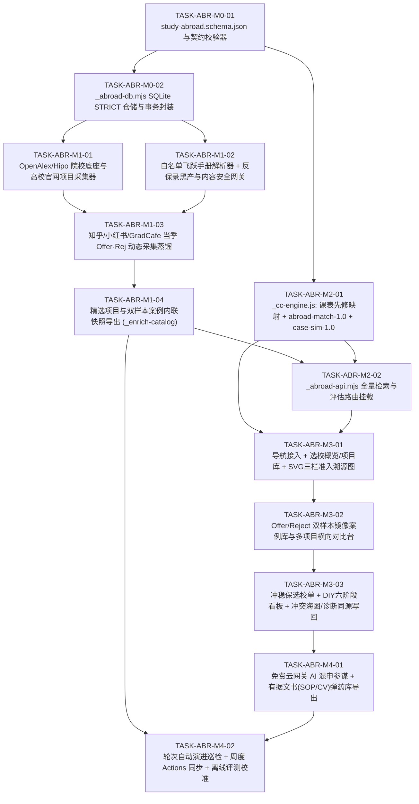

# Course Compass 留学·选校与开源案例库系统 · 演进路线与任务拆解规格书（SDD Roadmap）

> **SDD 规范元数据（Spec Metadata）**
> - **Spec ID**：`CC-SDD-ABR-03-ROADMAP`
> - **版本**：`v1.0.0`
> - **状态**：`Implemented & Verified (M0–M4 All Gates Green)`
> - **所属分支**：`feat/study-abroad-compass`
> - **关联规格书**：
>   - 需求规格书（PRD）：[`01-PRD-study-abroad.md`](./01-PRD-study-abroad.md)
>   - 技术与架构规格书：[`02-TECH-ARCH-study-abroad.md`](./02-TECH-ARCH-study-abroad.md)

---

## 1. 阶段演进里程碑规划（Milestones M0–M4）

延续「**Schema 契约先行 → 火爬双轨采集与开源案例入库 → 同构八维选校与案例引擎 → 五维一体工作台与冲突海图联动 → 副驾赋能与自动巡航**」的五步稳健迭代路线：

| 里程碑 | 阶段名称 | 核心交付物 | 预计周期 | 准出质量门禁（Exit Gate） |
| :--- | :--- | :--- | :---: | :--- |
| **M0** | **留学数据契约与 SQLite 仓储底座** | `study-abroad.schema.json`、`_abroad-contract.mjs`、`_abroad-db.mjs`（院校/项目/案例/巡航四类 STRICT 表） | 1.5 天 | 正反例 Schema 严格校验全绿（非法币种、缺失官网引文、越界均分、非法结果态 `100%` 拦截） |
| **M1** | **火爬双轨采集、开源飞跃库与反黑产蒸馏** | OpenAlex/Hipo 院校对齐 + 高校官网项目抓取器 + 白名单 GitHub 飞跃手册案例拆解器 + 知乎/小红书当季动态提纯 + 反保录黑产网关 | 3 天 | 首批覆盖英/港/新/欧/美澳 $\ge 60$ 个代表性硕士项目与 $\ge 120$ 条真实 Offer+Reject 双样本案例入库；黑产软广与无关仓库拦截率 $\ge 98\%$ |
| **M2** | **同构八维选校引擎 `abroad-match-1.0` 与 API** | `_cc-engine.js` 新增课表先修课映射、List/GPA/语言/预算八维评分、冲稳保定档及 `case-sim-1.0` 案例相似度检索；`_serve.mjs` 挂载 `/api/abroad/*` | 2.5 天 | 静态内联增量 `< 320KB`；四类典型学生画像硬门槛（卡 List / 缺欧陆先修课 / 预算超限）单测准确率 `100%`；匹配耗时 `< 30ms` |
| **M3** | **「留学·选校库」五维交互与全局冲突海图闭环** | 侧边栏新增 `留学·选校库`；实现项目库 SVG 三栏溯源、Offer/Rej 镜像案例库、跨国对比台、冲稳保 DIY 看板，并与 `路径与诊断 → C·留学` 同源对齐、自动写回 `冲突海图` | 3.5 天 | Playwright 无头浏览器 E2E 完整走通“建档选课 → 留学先修课自动核对 → 对标 Offer/Rej 案例 → 加入选校单 → 冲突海图自动出现语言与 Round1 节点” |
| **M4** | **AI 混申对比/有据文书副驾与周度自更新巡航** | 接入免费云网关流式混申策略对比、绑定 `evidenceId` 的有据文书（SOP/CV）提纲导出、滚动轮次自动演进与 GitHub Actions 定时更新集成 | 2 天 | 有据文书幻觉核验（缺失指标保留 `[待补充实测数据]`）通过；离线 NDCG@5 选校与案例相关性评测全绿 |

---

## 2. 研发任务依赖有向无环图（Executable Task DAG）

锁定 `TASK-ABR-M0-01` 数据契约后，**数据采集蒸馏管线（M1）** 与 **八维选校核心算法（M2-01）** 可完全并行开发：

---

## 3. 原子任务拆解清单（Sharded Atomic Tasks）

### 阶段 M0：留学数据契约与 SQLite 仓储底座

#### `TASK-ABR-M0-01`：建立 `study-abroad.schema.json` 与契约校验器
- **关联需求**：`CONST-ABR-01`, `CONST-ABR-04`, `REQ-ABR-01`, `REQ-ABR-02`
- **新增 / 修改文件**：
  - 新增 `study-abroad.schema.json`
  - 新增 `_abroad-contract.mjs`
  - 新增 `_abroad-contract-test.mjs`
- **实现要点**：定义 `University`、`StudyAbroadProgram`（含分梯度均分规则 `tierGpaRules`、先修课标签 `prereqCourseTags`、语言提交策略 `langPolicy`、官网原文引文 `requirementQuote`）与 `AdmissionCase`（强制枚举 `offer | conditional_offer | waitlist | reject`）。
- **验收门禁**：`node _abroad-contract-test.mjs` 校验合法样本通过、缺失官网链接或伪造字段样本 `100%` 抛错拦截。

#### `TASK-ABR-M0-02`：实现 `_abroad-db.mjs` SQLite 持久化层
- **关联需求**：`CONST-ABR-06`, 技术规格书第 3.1 节
- **前置依赖**：`TASK-ABR-M0-01`
- **新增 / 修改文件**：新增 `_abroad-db.mjs`
- **实现要点**：管理 `_research/abroad.db` 的建表迁移、原子事务批量 Upsert、SimHash 案例去重查询与按地区/学科/结果态高速检索。
- **验收门禁**：SQLite 事务回滚单测、重复案例幂等更新单测全绿。

---

### 阶段 M1：火爬双轨采集、开源飞跃库与反黑产蒸馏

#### `TASK-ABR-M1-01`：构建权威院校底座与高校官网 Programme 页面抓取解析器
- **关联需求**：`CONST-ABR-01`, `REQ-ABR-01`
- **前置依赖**：`TASK-ABR-M0-02`
- **新增 / 修改文件**：新增 `_abroad-program-ingestor.mjs`
- **实现要点**：对接 OpenAlex CC0 机构元数据与官方域名校验；调用 `_firecrawl-client.mjs` 抓取英、港、新、欧陆、美澳代表高校官网公开项目页，确定性提取学制、学费与语言小分要求并保留原文证据句。
- **验收门禁**：入库项目 `100%` 具备官方域名 HTTPS 链接与非空 `requirementQuote`。

#### `TASK-ABR-M1-02`：实现白名单开源《飞跃手册》解析器与双层安全/反黑产网关
- **关联需求**：`CONST-ABR-02`, `CONST-ABR-03`, `REQ-ABR-02`
- **前置依赖**：`TASK-ABR-M0-02`
- **新增 / 修改文件**：
  - 新增 `_abroad-cleaner.mjs`
  - 新增 `_abroad-feiyue-parser.mjs`
- **实现要点**：
  - 维护经人工核验许可协议的高校飞跃手册白名单 `VERIFIED_FEIYUE_REPOS` + 留学相关性守卫（物理阻断非留学无关/违规仓库）；
  - 实现反“保录取/免雅直录/扣1领选校表”黑产软广过滤器与双层 PII 脱敏；
  - 将单篇学长多申总结拆解为多条独立 `Offer` 与 `Reject` 细粒度案例。
- **验收门禁**：构造含保录黑产软广、无关非学术文本与真实飞跃总结的测试集，验证黑产与无关内容拦截率 $\ge 98\%$、PII 零残留。

#### `TASK-ABR-M1-03`：实现当季社区（知乎/小红书/公开榜）Offer/Rej 动态增量采集器
- **关联需求**：`REQ-ABR-02`, `CONST-ABR-04`
- **前置依赖**：`TASK-ABR-M1-01`, `TASK-ABR-M1-02`
- **新增 / 修改文件**：新增 `_crawl-abroad.mjs`
- **实现要点**：复用本地 Firecrawl `/v2/search` 与 `/v2/scrape`（遵守各渠道 `robots.txt`），结合免费云网关 `_employment-llm.mjs`（带纯规则兜底）提炼当季最新报 Offer / 拒信时间线与院校 List 变动线索。
- **验收门禁**：支持 `--dry-run` 与离线规则模式，产出数据 `100%` 通过契约校验。

#### `TASK-ABR-M1-04`：打通 `_cc-data.json` 精选留学快照导出与内联体积门禁
- **关联需求**：`CONST-ABR-06`, PRD 第 5 节体积指标
- **前置依赖**：`TASK-ABR-M1-03`
- **新增 / 修改文件**：修改 [`_enrich-catalog.mjs`](../../../_enrich-catalog.mjs)、[`_build-inline.mjs`](../../../_build-inline.mjs)、[`employment.schema.json`](../../../employment.schema.json)
- **实现要点**：按六大热门地区与五大专业赛道均衡抽样精选项目及配套 `Offer + Reject` 案例写入 `data.studyAbroad`，并在 `_build-inline.mjs --check` 强制校验 `studyAbroad` 字节数 `< 320KB`。
- **验收门禁**：`node _build-inline.mjs --check` 通过且既有 682 条就业岗位快照哈希保持零漂移。

---

### 阶段 M2：同构八维选校引擎 `abroad-match-1.0` 与服务端 API

#### `TASK-ABR-M2-01`：在 `_cc-engine.js` 实现先修课自动核对、八维选校精算与案例相似度引擎
- **关联需求**：`REQ-ABR-03`, `REQ-ABR-04`, `CONST-ABR-04`, `CONST-ABR-05`
- **前置依赖**：`TASK-ABR-M0-01`
- **新增 / 修改文件**：修改 [`_cc-engine.js`](../../../_cc-engine.js)、[`_smoke.mjs`](../../../_smoke.mjs)
- **实现要点**：
  - 实现 `CC.auditPrerequisites(courses, program)`：将学生已修/在修课程自动映射至 8 类先修能力簇并逐项核对；
  - 实现 `CC.evaluateAbroadProgram(profile, abroadPrefs, program, now)` 与 `CC.matchAbroadPrograms(...)`：输出资格四态、八维因子明细与 `reach / match / safety / blocked` 定档；
  - 实现 `CC.similarAbroadCases(profile, cases, { programId })`：独立返回相似 `Offer` 样本与相似 `Reject` 警示样本。
- **验收门禁**：`_smoke.mjs` 验证双非卡 List 拦截、欧陆缺数学/编程先修课拦截、无雅可申 `CONDITIONAL` 判定及 200+ 项目匹配耗时 `< 30ms`。

#### `TASK-ABR-M2-02`：挂载 `/api/abroad/*` 服务端全量检索与评估路由
- **关联需求**：技术规格书第 5.2 节
- **前置依赖**：`TASK-ABR-M1-04`, `TASK-ABR-M2-01`
- **新增 / 修改文件**：新增 `_abroad-api.mjs`、修改 [`_serve.mjs`](../../../_serve.mjs)
- **实现要点**：挂载 `/api/abroad/programs`、`/api/abroad/cases`、`/api/abroad/evaluate` 及回环专属 `/api/abroad/crawl/trigger`，共享同源安全检查与速率限制。
- **验收门禁**：同源正常返回、跨域 `403` 拒绝、非回环触发爬虫 `403` 拒绝单测全绿。

---

### 阶段 M3：「留学·选校库」五维交互与全局时间闭环 UI

#### `TASK-ABR-M3-01`：接入侧边栏「留学·选校库」与项目库 + SVG 三栏准入溯源视图
- **关联需求**：`CONST-ABR-05`, `REQ-ABR-03`, PRD 第 3.2 节
- **前置依赖**：`TASK-ABR-M2-01`, `TASK-ABR-M2-02`
- **新增 / 修改文件**：修改 [`index.html`](../../../index.html)
- **实现要点**：
  - 侧边栏「方向探索与规划」分组新增 `留学·选校库`（位于 `就业·岗位库` 旁）；
  - 首屏继承个人档案并提供地区、年预算、当前语言状态行内配置条；
  - 项目详情页渲染八维准入卡片、课表先修课逐门核对清单及 **SVG 三栏溯源图（我的档案事实 → 八维准入核验 → 高校官网原文引文）**。
- **验收门禁**：零重复填表即可直接看到个性化定档结果，静态与本地服务双模式零报错。

#### `TASK-ABR-M3-02`：实现 Offer/Reject 双样本镜像案例库与多项目横向对比台
- **关联需求**：`CONST-ABR-04`, `REQ-ABR-04`, PRD 第 3.2 节
- **前置依赖**：`TASK-ABR-M3-01`
- **新增 / 修改文件**：修改 [`index.html`](../../../index.html)
- **实现要点**：
  - 案例库支持按本科梯度、均分区间、专业族、`Offer / Reject` 结果态及「👤 只看与我相似背景」一键过滤；
  - 横向对比台支持勾选 2–4 个跨地区项目同屏比对年总预算、卡 List 程度、先修课缺口、语言递交机制、轮次截止日与毕业工签。
- **验收门禁**：案例卡片清晰区分录取与拒信并提供原出处跳转；对比台支持一键增删对比项。

#### `TASK-ABR-M3-03`：打通冲/稳/保选校单、DIY 六阶段看板与《冲突海图》/诊断同源联动
- **关联需求**：`REQ-ABR-05`, PRD 第 3.1 & 3.2 节
- **前置依赖**：`TASK-ABR-M3-02`
- **新增 / 修改文件**：修改 [`index.html`](../../../index.html)、[`_employment-e2e.mjs`](../../../_employment-e2e.mjs)
- **实现要点**：
  - `路径与诊断 → C·留学` 改为直接调用 `abroad-match-1.0` 同源摘要（消除原静态硬编码粗糙文案）；
  - 选校单自动评估冲/稳/保结构失衡风险，支持六阶段申请进度切换；
  - 选校单内项目的语言死线与首轮网申窗口自动同步进全局行动清单与《冲突海图》（随本机 `AES-GCM` 账号加密持久化）。
- **验收门禁**：无头浏览器 E2E 验证从建档选课 → 留学定位 → 选校入单 → 诊断页同源一致 → 冲突海图时间节点自动渲染全链路通过。

---

### 阶段 M4：AI 混申参谋、有据文书弹药库与自动巡航

#### `TASK-ABR-M4-01`：实现多项目混申 AI 参谋与绑定 `evidenceId` 的有据文书素材导出
- **关联需求**：`REQ-ABR-06`, `CONST-ABR-06`
- **前置依赖**：`TASK-ABR-M3-03`
- **新增 / 修改文件**：修改 `_abroad-api.mjs`、[`index.html`](../../../index.html)
- **实现要点**：
  - 复用魔搭/硅基流动/智谱纯免费流式网关与零显存规则兜底，提供多国混申投递节奏建议；
  - 将学生已核验课程与经历工坊成果对齐目标项目 `coreModules`，生成有据 SOP/PS 与 Academic CV 要点，缺失量化指标强制保留 `[待补充实测数据]`，支持 `.md` 一键导出。
- **验收门禁**：无实证指标绝不编造数字断言通过；离线零云端秘钥时专家规则兜底正常生成。

#### `TASK-ABR-M4-02`：落地轮次自动演进巡检、GitHub Actions 定时同步与离线评测扩展
- **关联需求**：技术规格书第 5.1 节
- **前置依赖**：`TASK-ABR-M1-04`, `TASK-ABR-M4-01`
- **新增 / 修改文件**：修改 [`.github/workflows/weekly-intel-sync.yml`](../../../.github/workflows/weekly-intel-sync.yml)、[`_employment-eval.mjs`](../../../_employment-eval.mjs)
- **实现要点**：将留学当季案例与项目轮次状态刷新并入周度自动化工作流（全套门禁通过后方可更新快照），并在 `_employment-eval.mjs --self-test` 增加留学选校与相似案例 `NDCG@5` 自检。
- **验收门禁**：全量回归命令（`check:experience` + `check:abroad` + `check:employment`）全部 Exit Code `0`。

---

## 4. 需求—架构—测试双向追溯矩阵（RTM）

| PRD 需求 ID | 核心规格摘要 | 架构章节（`02-TECH-ARCH`） | 研发任务 ID | 自动化验收门禁 |
| :--- | :--- | :--- | :--- | :--- |
| `CONST-ABR-01` / `REQ-ABR-01` | 严禁盗爬竞品；官网+OpenAlex/Hipo 权威建库与引文溯源 | §2.1, §3.1 | `TASK-ABR-M0-01`, `M1-01` | `_abroad-contract-test.mjs` 官方域名与 `requirementQuote` 必填断言 |
| `CONST-ABR-02` / `CONST-ABR-03` / `REQ-ABR-02` | 开源飞跃白名单安全守卫 + 反保录黑产拦截 + 双层 PII 脱敏 | §2.1, §2.2 | `TASK-ABR-M1-02`, `M1-03` | 黑产软广与无关仓库拦截基准测试（拦截率 $\ge 98\%$）+ PII 扫描 |
| `CONST-ABR-04` / `REQ-ABR-04` | Offer + Reject 双样本诚实对标，拒绝伪精确录取率 | §3.1, §4.1, §4.2 | `TASK-ABR-M2-01`, `M3-02` | `case-sim-1.0` 双样本召回单测 + UI 录取/拒信双视图 E2E 断言 |
| `CONST-ABR-05` / `REQ-ABR-03` | 个人档案与课表一次录入自动核对先修课、List、GPA 与预算 | §3.2, §4.1 | `TASK-ABR-M2-01`, `M3-01` | `_smoke.mjs` 四画像硬门槛核验 `100%` 准确 + 诊断页同源一致性 E2E |
| `REQ-ABR-05` | 冲/稳/保选校组合诊断与《冲突海图》语言/网申死线写回 | §1, §5.1 | `TASK-ABR-M3-03` | `_employment-e2e.mjs` 选校入单联动冲突海图节点可见性断言 |
| `REQ-ABR-06` / `CONST-ABR-06` | 有据文书素材绑定 `evidenceId` + 静态/本地双模零本地 GPU | §1, §5.2 | `TASK-ABR-M1-04`, `M4-01`, `M4-02` | `[待补充实测数据]` 防幻觉单测 + `_build-inline.mjs --check`（`< 320KB`） |

---

## 5. 关键工程风险与应对预案（Risk Mitigation）

| 风险场景 | 风险等级 | 工程防控与兜底机制 |
| :--- | :---: | :--- |
| **英国高校当年大陆院校 List 动态微调或未在官网直接贴出完整名单** | 高 | 在 `tier_gpa_rules_json` 中显式区分 `official_published`（官网明示分数表）与 `case_calibrated`（基于近两年真实 Offer/Rej 样本归纳区间）；对未公开完整名单的项目诚实展示为 `CONDITIONAL · 需核对当年网申院校库`，绝不武断误判。 |
| **外币汇率波动影响人民币总预算筛选边界** | 低 | 在快照元数据维护基准折算汇率表（带更新日期），并在预算边缘（超出预算 $\le 10\%$）标记 `接近预算上限` 而非生硬一刀切隐藏。 |
| **GitHub 泛检索返回非学术、盗版书单或敏感违规仓库** | 高 | 严格执行 `CONST-ABR-02`：开源飞跃手册采集默认仅拉取 `VERIFIED_FEIYUE_REPOS` 人工审计白名单仓库；任何动态发现的新仓库必须先落入 `abroad_repo_candidates` 隔离池经领域特征与安全规则校验，绝不自动进入公开构建。 |
| **全站静态包（就业 682 岗 + 实战经验 + 留学库）总体积增长** | 中 | 实施严格模块配额预算（就业岗位 + 实战情报 `< 280KB` + 留学精选项目与案例 `< 320KB`），详细长文与万级历史案例全部下沉至本地 `_research/abroad.db` 按需 API 读取，确保静态首页秒开。 |
